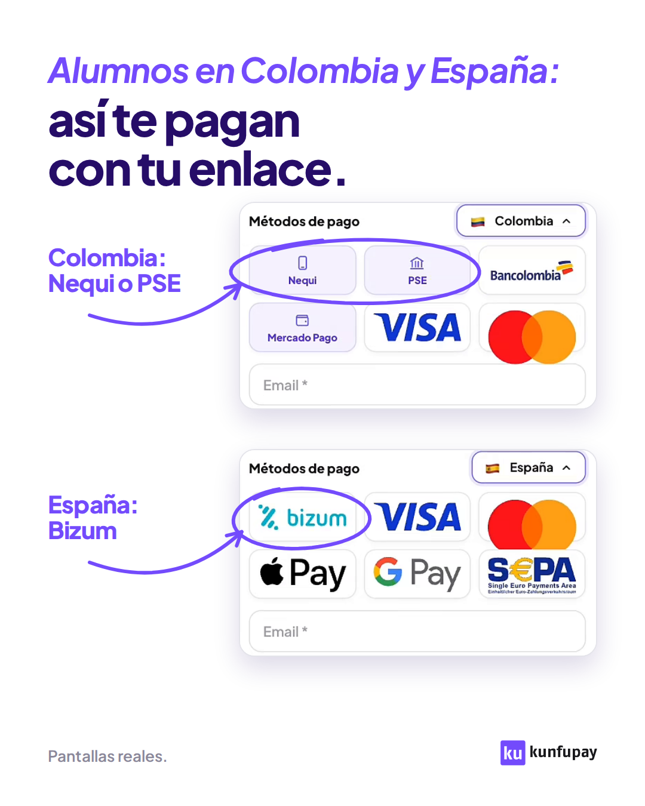

pie-pdf: Guía 3 · Copys, subida y medición · Kunfupay
::portada Kunfupay · Marketing · Guía 3 | Copys, nombres, subida a Meta y medición | Qué texto lleva cada anuncio, cómo se llama, cómo se sube y cómo sabemos si funciona. Paso a paso y con el **porqué** de cada cosa. | Versión del 13 de noviembre de 2026 · Acompaña al Documento maestro de creatividades
::indice

## Cuántos textos lleva un anuncio || Hoy: 2 textos y 2 títulos. En Classroom Platinum, 5 y 5

{lead} Cada anuncio lleva **2 textos y 2 títulos**. Un texto es muy largo y el otro es corto: el largo mide unas 5 veces el corto. En Classroom Platinum son 5 textos y 5 títulos.

### Las piezas de un anuncio

Estas son las piezas que se rellenan al subir un anuncio a Meta. En toda la guía se llaman así.

::pizarratexto w=236

<b>kunfupay</b> · Publicidad

Mira la imagen: eso es lo que ve tu alumno cuando abre tu enlace de Kunfupay. El de España con sus métodos… Ver más

kunfupay.comRegistrarte

<b>Así te paga cada alumno</b>

--
L 0.04,0.105 | Texto principal | Hay 2 por anuncio: uno largo y uno corto. Va escrito, fuera de la imagen.
L 0.04,0.50 | Imagen o vídeo | En estáticos se suben dos tamaños: 4:5 para el feed y 9:16 para Stories y Reels.
L 0.04,0.897 | URL visible | La dirección que se lee junto al botón. Siempre kunfupay.com.
L 0.04,0.952 | Título | Hay 2 por anuncio. De 40 caracteres como máximo y muy distintos entre sí.
R 0.965,0.206 | «Ver más» | Meta corta el texto. Solo se ven las primeras líneas: por eso el gancho va arriba.
R 0.965,0.897 | Botón | El mismo que llevan los anuncios activos del conjunto. Si no hay, «Registrarte» o «Ver más».
R 0.72,0.952 | Descripción | Iría junto al título. Antes llevábamos una. Hoy no se usa.
pie: Esquema de un anuncio con las piezas reales de «ESTATICA / PAGINA DE PAGO / LATAM». No es una captura: la posición de cada pieza cambia según la ubicación.
::fin

### La norma de hoy

- **Texto largo:** de 1.250 a 1.500 caracteres. Escrito de tú a tú. Filtra y lo explica todo.
- **Texto corto:** de 175 a 310 caracteres. Lo mismo, en tres o cuatro frases.
- **2 títulos:** de 40 caracteres como máximo y muy distintos entre sí.
- **Sin descripción.** Ya no se usa.

Los 2 textos y los 2 títulos se suben como **opciones** del mismo anuncio y valen para todas las ubicaciones. Meta enseña unas veces uno y otras veces otro. Según la ubicación solo cambia la imagen.

> **Por qué un texto tan largo:** lo pidió Benja con estas palabras: «uno que sea SUPER largo, con mucho copy, que filtre bien, que explique todo, con copy que sea como escrito de tú a tú, y otro que sea más corto. Dos copys y dos títulos». El largo tiene dos trabajos. **Filtrar:** que quien todavía no vende se descarte solo. **Explicar todo:** el problema, cómo funciona y para quién es, antes del clic.

<figure>

Texto único de antes (6-10-2026)

<strong>562</strong>

Texto largo de hoy

<strong>1.330</strong>

Texto corto de hoy

<strong>242</strong>

<figcaption>Caracteres de cada texto. Hoy: media de los 25 estáticos de los hubs (el largo mide 5,5 veces el corto). Antes: el estático «cripto a euros».</figcaption></figure>

### Qué había antes y qué cambió

En el sistema del 6 de octubre de 2026, cada anuncio llevaba **1 texto, 1 título y 1 descripción**. El texto era más corto, sin cifras y sin la lista «Esto es para ti si:».

Cambió en dos pasos:

1. **Octubre de 2026.** Al subir los anuncios de los hubs, Benja pide «dos copys y dos títulos».
2. **30-10-2026.** Benja revisa lo subido y corrige: «te falta un copy súper extenso que sea unas 5 veces el que ya está y un segundo título muy distinto». El texto largo pasó a medir de 1.250 a 1.470 caracteres: de 5 a 6 veces el corto.

### Cuántos lleva cada línea

| Línea | Textos | Títulos | Botón |
|---|---|---|---|
| Métodos de pago · hubs (estáticos y reels) | 2: largo de 1.160 a 1.510 caracteres y corto de 175 a 310 | 2 | Registrarte |
| Métodos de pago · España | 2: largo de 1.260 a 1.460 y corto de 217 a 249 | 2 | Registrarte en los estáticos y Ver más en el reel |
| Optimización fiscal · reels de noviembre | 2: largo de 1.100 a 1.320 y corto de 240 a 343 | 2 | Ver más |
| Classroom Platinum · reels | 5, de muy largo a muy corto: de unos 1.380 a 60 caracteres | 5 | Ver más |
| Remarketing de vendedores (documento del 29-10-2026; pendiente de confirmar si pasa a 2 y 2) | 1 por ubicación: largo en el feed y corto en Stories y Reels | 1 por ubicación | Más información |
| Sistema anterior (6-10-2026) | 1, de 560 a 710 caracteres, más 1 descripción | 1 | Registrarte |

## El texto largo, destripado || Un texto real con flechas y la receta para escribirlo

{lead} El texto largo tiene cuatro partes, siempre en este orden: **gancho, cuerpo, filtro y cierre**. Dentro de un conjunto, de un anuncio a otro solo cambia el gancho.

Este es el texto largo de «ESTATICA / PAGINA DE PAGO / LATAM». Es el anuncio que trajo 26 de los 27 leads del hub LATAM, a 1,94 € por lead (auditoría del 10-11-2026). Su imagen está en la Parte 1.

::pizarratexto w=300

Mira la imagen: eso es lo que ve tu alumno cuando abre tu enlace de Kunfupay. El de España con sus métodos, el de LATAM con los suyos.

Te cuento algo que seguro te ha pasado.

Alguien te escribe, le encanta lo que haces, le mandas el enlace de pago… y ahí se queda. No es que no quiera tu curso. Es que su tarjeta no pasa, no tiene tarjeta internacional o en su país se paga de otra forma. Al día siguiente ya se le pasó la emoción. Y esa venta no vuelve.

Cuando cobras solo con tarjeta, hasta un 27 % de las ventas se cae justo en el pago. Y casi nunca te enteras, porque no te dicen «no pude pagar»: simplemente desaparecen.

Con Kunfupay cambia una sola cosa: cómo te pagan. Creas tu enlace de pago y lo mandas como siempre. Tu alumno lo abre y le salen los métodos que usa en su país, en su moneda. Paga en el momento, sin escribirte para preguntar cómo. Y a ti te llega en euros o en dólares.

No cambias lo que vendes. No haces otro lanzamiento. No persigues a nadie por WhatsApp. Solo dejas de perder a los que ya te querían comprar.

Esto es para ti si: ✅ Ya vendes cursos, mentorías, comunidades o sesiones online. ✅ Tienes clientes en más de un país (o los quieres tener). ✅ Alguna vez alguien te dijo «quiero entrar, pero no puedo pagarte».

Si todavía no vendes, esto no es para ti.

Entra y mira si tu negocio encaja.

Kunfupay es una empresa de tecnología financiera, no un banco. Las cuentas y tarjetas las prestan partners financieros con licencia.

--
R 0.985,0.045 | El gancho casa con la imagen | «Mira la imagen» manda a mirar la captura del anuncio. Texto e imagen cuentan lo mismo.
R 0.985,0.212 | El cuerpo: el dolor, de tú a tú | Una venta que se cae al pagar, contada como a un amigo. Debajo, la cifra con «hasta»: pone un techo, no promete.
R 0.985,0.493 | El cuerpo: el giro y cómo funciona | Una frase fija y cuatro líneas: qué haces tú, qué ve tu alumno y qué moneda recibes.
R 0.985,0.68 | «Esto es para ti si:» | El filtro en positivo. Quien cumple las tres líneas se siente llamado.
R 0.985,0.856 | «Si todavía no vendes…» | El filtro en negativo. Kunfupay revisa cada negocio: a quien aún no vende no se le aprueba la tienda.
R 0.985,0.888 | «Entra y mira si tu negocio encaja» | No dice «empieza hoy» porque la cuenta se revisa antes de activarla.
R 0.985,0.943 | El aviso legal | Fijo, palabra por palabra. Dice qué es Kunfupay y qué no es: no es un banco.
pie: Texto largo de «ESTATICA / PAGINA DE PAGO / LATAM»: 1.466 caracteres.
::fin

<b>1. Gancho</b>Cambia en cada anuncio. Casa con su imagen o con su vídeo.

<b>2. Cuerpo</b>Uno por conjunto. Se repite en todos sus anuncios.

<b>3. Filtro</b>Fijo. «Esto es para ti si:» y tres líneas.

<b>4. Cierre</b>Fijo. Dos frases y el aviso legal.

### La receta, paso a paso

<ol class="pasos">
<li><strong>Mira el anuncio antes de escribir</strong> En un estático, lee el titular de la imagen. En un reel, apunta el gancho, la cifra y el cierre. Por qué: «El copy tiene que contar lo mismo que el vídeo y repetir su cifra tal cual». Si el vídeo dice «hasta un 30 %», el texto dice «hasta un 30 %».</li>
<li><strong>Escribe el gancho</strong> Un solo párrafo. Es el mismo gancho del vídeo o el titular de la imagen. Es lo único que se escribe nuevo en cada anuncio. Por qué: el texto y la imagen tienen que contar lo mismo. Y como Meta corta el texto, lo primero que se lee es el gancho.</li>
<li><strong>Pega el cuerpo del conjunto</strong> Se escribe una vez por conjunto. Lleva, en este orden: una frase de tú a tú («Te cuento algo que seguro te ha pasado.»), la escena del dolor, la cifra, el giro («Con Kunfupay cambia una sola cosa: cómo te pagan.») con cuatro líneas de cómo funciona, y lo que no cambia («Mismo producto. Mismo precio.»).</li>
<li><strong>Pega el filtro</strong> «Esto es para ti si:» y tres líneas con una marca de verificación delante. La primera siempre es «Ya vendes cursos, mentorías, comunidades o sesiones online.»</li>
<li><strong>Pega el cierre</strong> Tres frases fijas: «Si todavía no vendes, esto no es para ti.», «Entra y mira si tu negocio encaja.» y el aviso legal.</li>
<li><strong>Mide</strong> El largo tiene que medir unas 5 veces el corto. El generador de copys de España no deja pasar un largo que mida menos de 4 veces el corto.</li>
</ol>

> **Por qué se echa a quien no vende:** en el informe de calidad de leads del 1 al 25 de octubre de 2026, de 364 leads válidos, 223 (el 61 %) acabaron con la tienda rechazada. El motivo casi siempre fue «falta volumen de facturación: negocio nuevo o sin ventas suficientes». El anuncio tiene que hacer ese filtro antes del clic.

::salto

### Cómo abre cada tipo de anuncio

El gancho depende de lo que enseña la pieza. Estos son ganchos reales.

| Tipo de anuncio | Qué hace el gancho | Ejemplo real |
|---|---|---|
| TWEET | Dolor con cifra y culpable | «Si vendes cursos desde Miami y cobras con Stripe, estás perdiendo hasta un 27 % de tu facturación. Y lo peor es que casi nunca lo ves.» |
| COMPARATIVA | Manda a mirar la tabla | «Pon lado a lado cómo cobras hoy con Stripe y cómo podrías cobrar. Mismos dólares para ti. Pero la diferencia en ventas es de hasta un 27 %.» |
| PAGINA DE PAGO | Manda a mirar la captura | «Mira la imagen: eso es lo que ve tu cliente de LATAM cuando abre tu enlace de Kunfupay. Cada uno, con lo que usa en su país.» |
| DESEO | Pregunta con la ganancia | «¿Y si pudieras facturar hasta un 30 % más desde Miami sin vender ni un curso más? Solo cambiando cómo cobras.» |
| NOTICIA | Otros ya lo hacen | «Creadores en Miami ya aumentan su conversión un 27 % solo cambiando cómo cobran. No venden más: cobran mejor.» |
| REEL | Repite el gancho del vídeo | ««¿Y cómo te pago?» Si vendes cursos desde Dubái, esa pregunta te está costando ventas.» |

### En fiscal y en Classroom Platinum cambia un poco

| Parte | Métodos de pago | Optimización fiscal | Classroom Platinum |
|---|---|---|---|
| Después del gancho | Frase de tú a tú | Un puente corto: «Te explico por qué.» | Un puente corto: «Piénsalo un segundo.» |
| Filtro | «Esto es para ti si:» y tres líneas | «Para quién es:», con lo que sí y lo que no. Deja fuera los productos físicos | Requisitos con cifra: «Ya vendes y facturas más de 3.000 € al mes.» |
| Frase que no falta | La moneda que recibes: «Y a ti te llega en euros.» | «Tu renta, eso sí, sigue siendo tuya.» | La escasez: «Son solo 100 plazas.» |
| Llamada a la acción | «Entra y mira si tu negocio encaja.» | «Entra y mira si tu negocio encaja.» | «Aplica en 2 minutos y mira si tu negocio califica.» |
| Aviso legal | Sí | Sí | No lo lleva |

## El texto corto y los títulos || La plantilla, ejemplos reales y el caso que corrigió Benja

{lead} El texto corto dice lo mismo que el largo en tres o cuatro frases. Los dos títulos tienen que decir cosas distintas: si se parecen, sobra uno.

### El texto corto

::pizarratexto w=262

Si vendes cursos desde España y cobras con Stripe, pierdes hasta un 27 % de tu facturación.

Tus alumnos de LATAM quieren comprarte. Y no pueden pagarte.

PERO con tu enlace de Kunfupay, sí. Y a ti te llegan euros.

Haz clic y descubre cómo.

Título 1 · <b>Stripe te hace perder hasta un 27 %</b>

Título 2 · <b>Tu alumno de LATAM sí quiere pagarte</b>

--
R 0.985,0.09 | Filtro y cifra, en la primera frase | Quien no vende cursos deja de leer aquí. Quien sí, ya tiene el dato.
R 0.985,0.34 | El dolor, en dos frases | Lo mismo que el largo cuenta en un párrafo entero.
R 0.985,0.50 | «PERO» y la moneda | El giro en mayúsculas y lo que recibes tú: euros.
R 0.985,0.66 | Llamada a la acción | Siempre la misma en el texto corto: «Haz clic y descubre cómo.»
R 0.985,0.82 | Título 1: el problema | Repite la cifra y nombra la herramienta que la persona usa hoy.
R 0.985,0.935 | Título 2: otra idea | No repite el 27 %. Dice que el cliente sí quiere pagar.
pie: Texto corto (241 caracteres) y títulos del estático tipo tweet de España. Su texto largo mide 1.448 caracteres: 6 veces más.
::fin

El texto corto tiene tres o cuatro bloques, separados por una línea en blanco. No lleva la lista «Esto es para ti si:» ni el aviso legal. De los 25 cortos de los estáticos de hubs, 20 empiezan con un «Si…» que filtra. Los otros 5 son los de noticia y empiezan con «Creadores en…».

### Los títulos

1. **40 caracteres como máximo.** Lo fija el método de subida.
2. **Los dos dicen cosas distintas.** No vale la misma idea con otras palabras.

| Anuncio | Título 1 | Título 2 | En qué se diferencian |
|---|---|---|---|
| ESTATICA / DESEO / MIAMI | «Hasta un 30 % más desde Miami» | «Cambia cómo cobras» | La ganancia y lo que hay que hacer |
| REEL / COMO TE PAGO / DUBAI | ««¿Cómo te pago?» te cuesta ventas» | «Que nadie vuelva a preguntártelo» | El problema y la salida |
| REEL / JORGE GPT / FISCAL | «Se lo pregunté a ChatGPT» | «El IVA de cada venta ya no es tuyo» | La curiosidad y el beneficio |

### El caso que corrigió Benja

El 30-10-2026, en tres anuncios de página de pago el segundo título se parecía demasiado al primero. Se rehízo.

| Anuncio | Título 1 | Título 2, antes | Título 2, después |
|---|---|---|---|
| PAGINA DE PAGO / MIAMI | «Así te paga cada cliente de LATAM» | «Esto ve tu cliente al pagar» | «Un enlace y tú recibes dólares» |
| PAGINA DE PAGO / LATAM | «Así te paga cada alumno» | «Esto ve tu alumno al pagar» | «Cobra a todos con un solo enlace» |
| PAGINA DE PAGO / DUBAI | «Esto ve tu cliente al pagarte» | «Así te paga cada cliente» | «España y LATAM, en un solo enlace» |

> **Por qué:** Benja pidió «un segundo título muy distinto». Antes, los dos títulos decían lo mismo: mira lo que ve tu cliente. El nuevo título 2 cuenta otra cosa: un solo enlace y la moneda que recibes. Dos títulos casi iguales son, en la práctica, uno solo.

### En Classroom Platinum: una escalera de 5

Los 5 textos van del más largo al más corto. Cada uno quita cosas al anterior. Ejemplo: el reel «VC MONEY».

| Texto | Caracteres | Qué deja |
|---|---|---|
| 1 | 1.379 | Todo: gancho, cómo funciona, quién pone qué, requisitos, escasez y llamada a la acción |
| 2 | 657 | Un resumen de todos los bloques |
| 3 | 325 | Gancho, reparto, requisito, escasez y llamada a la acción |
| 4 | 194 | Tres frases |
| 5 | 93 | Una línea: «Presupuesto para anuncios, plataforma y equipo: lo ponemos nosotros. Solo 100 plazas. Aplica.» |

> **Por qué 5 y 5:** lo pidió Benja el 2-11-2026: «créale a cada uno sus 5 copys de muy largos a más cortos, con 5 títulos bien cortos y completamente distintos». Por qué ahí son 5 y no 2 no está escrito: pendiente de confirmar.

Los 5 títulos tiran cada uno de una idea: «Presupuesto ilimitado para tu curso» (la promesa), «Solo 100 plazas» (la escasez), «Tú pones el curso, nosotros el dinero» (el reparto), «Si ganas tú, ganamos nosotros» (el trato) y «¿Facturas +3.000 €/mes?» (el filtro).

## Lo que el copy nunca dice y lo que sí || Impuestos, precio, otras marcas, cifras y a quién se habla

{lead} Kunfupay es un servicio financiero. Meta revisa estos anuncios con más cuidado, y una frase de más puede tumbar el anuncio o prometer algo que no es verdad. Estas reglas valen para todos los textos y títulos.

### Impuestos

<h4>Sí se dice</h4><ul><li>«Los impuestos de cada venta ya no son tuyos.»</li><li>«Y los impuestos de esa venta son cosa nuestra.»</li><li>«La factura de cada venta se la hacemos nosotros.»</li><li>«Somos tus representantes en cada venta.»</li><li>«Tu renta, eso sí, sigue siendo tuya.»</li><li>«Te ahorras la LLC, su renovación, su asesor y su papeleo.»</li></ul>

<h4>No se dice</h4><ul><li>«Ahorra impuestos» ni «paga menos impuestos».</li><li>«Ya pagamos los impuestos por ti.»</li><li>«Te ahorras el 21 %.»</li><li>«No pagas IVA» ni «no pagas impuestos».</li><li>«Hacienda no lo ve» ni «100 % seguro».</li><li>Que el Merchant of Record es «el vendedor oficial» o «la pasarela».</li></ul>

> **Por qué:** los impuestos no desaparecen: cambian de quién son. Benja lo resume así: «no decimos que te ahorras, sino que lo pagamos nosotros». Kunfupay te representa en cada venta: le hace la factura al cliente y se ocupa de los impuestos de esa venta. Prometer que «te ahorras un montón de impuestos» es falso dicho así, y Meta lo frena en servicios financieros.
>
> **Ojo con la frase exacta.** Siempre son los impuestos «de cada venta» o «de esa venta». Nunca «tus impuestos» a secas. Y siempre se añade el límite: «Tu renta, eso sí, sigue siendo tuya». Quien vive en España paga por todo lo que gana, esté donde esté el dinero.

Dos avisos:

- **El vídeo a veces dice más que el texto.** El 3-11-2026 se vio que en dos vídeos de Rubén el audio dice «pagar el mínimo posible por tus ventas» y «ahorrar lo mismo que si vivieras en Andorra». El texto del anuncio no repite esas frases.
- **«Ahorrar» sí vale para la LLC.** Te ahorras la LLC y su papeleo, no los impuestos.

### Precio, ofertas y promesas

<h4>Sí se dice</h4><ul><li>La ganancia en condicional: «podrías facturar hasta un 30 % más».</li><li>Que hay revisión: «mira si tu negocio encaja».</li><li>El requisito, con su cifra: «Ya vendes y facturas más de 3.000 € al mes.»</li></ul>

<h4>No se dice</h4><ul><li>«Gratis» ni «0 %».</li><li>«Sin comisiones» ni «más barato».</li><li>Resultados garantizados ni plazos: «en minutos», «en 1 día».</li><li>Precios, importes o comisiones concretas.</li></ul>

> **Por qué:** Kunfupay no publica un precio único («precio a medida»), así que no se puede comparar ni prometer. La guía de marca veta «sin comisiones». «Gratis» y «0 %» solo entrarían con una oferta cerrada, y hoy no la hay. En Classroom Platinum tampoco se dice «gratis», aunque lo diga la web: el programa va con la suscripción a Classroom. Meta no admite resultados garantizados en servicios financieros.

### Otras marcas

<h4>Sí se dice</h4><ul><li>Stripe, PayPal, Hotmart o Skool, como palabra.</li><li>Comparar: «Cobras con Kunfupay, igual que con Stripe. PERO la factura se la hacemos nosotros.»</li><li>Lo que le pasa al cliente: «tu enlace solo acepta tarjeta o PayPal».</li></ul>

<h4>No se dice</h4><ul><li>«Stripe no funciona» ni «Stripe no puede».</li><li>Datos de otra marca sin fuente.</li><li>Comparar comisiones.</li><li>Sus logos: la otra marca va solo como palabra.</li></ul>

> **Por qué:** la regla es «comparar sí, denigrar no». Tachar el logo de otra empresa se puede leer como denigrarla: lo impide la Ley de Competencia Desleal, y Meta retira el anuncio si la marca lo denuncia. Se nombra la herramienta que la persona usa hoy, no algo genérico. Benja lo corrigió el 3-11-2026: «deja de perder ventas cobrando solo con Stripe», en vez de «solo con tarjeta». La revisión legal de las comparativas con Stripe, PayPal y Hotmart está pendiente.

### Cifras

<h4>Sí se dice</h4><ul><li>«Hasta un 27 %» para lo que pierdes.</li><li>«Hasta un 30 % más» para lo que podrías ganar.</li><li>La misma cifra que dice el vídeo o la imagen.</li><li>Con espacio antes del signo: «27 %».</li></ul>

<h4>No se dice</h4><ul><li>Cifras nuevas que no use ya la marca.</li><li>Cifras de ingresos de clientes.</li><li>Cuántos métodos de pago tiene Kunfupay: la web da cuatro cifras distintas.</li></ul>

> **Por qué:** lo dice Benja: «siempre mencionamos un % por el sesgo y que sea más real, evitamos números redondos». Con un porcentaje, el dato suena más real. «Hasta» pone un techo y no promete.
>
> **Pendiente de confirmar:** de dónde salen el 27 % y el 30 %. No está escrito en ningún documento. Además, el 27 % se usa con tres sentidos (facturación que pierdes, ventas que se caen al pagar y aumento de conversión) y el reel «Deja de perder ventas» habla de perder «hasta un 30 %».

### A quién se habla

<h4>Sí se dice</h4><ul><li>A quien ya vende: cursos, mentorías, comunidades o sesiones online.</li><li>De tú, en español de España.</li><li>El lugar y la situación: «Si vendes cursos desde Miami…».</li><li>«Alumno» en España y LATAM. «Cliente» en Miami, Dubái, Bali y Tailandia.</li></ul>

<h4>No se dice</h4><ul><li>Nada para quien quiere empezar a vender.</li><li>Rasgos personales: «si eres latino», «¿tienes problemas con Hacienda?».</li><li>«Vos» ni regionalismos.</li><li>La cripto, en Bali y en Tailandia.</li></ul>

> **Por qué:** Benja: «usamos siempre infoproductores o coaches, o productos digitales». Meta no deja insinuar que conoces la situación de quien mira: por eso se nombra el lugar y lo que pasa, no a la persona. En Indonesia y en Tailandia la cripto está prohibida como medio de pago: allí no aparece en ninguna pieza.

### El aviso legal

Es fijo y no se toca: «Kunfupay es una empresa de tecnología financiera, no un banco. Las cuentas y tarjetas las prestan partners financieros con licencia.» Va al final de los textos largos de métodos de pago y de fiscal. Los textos cortos no lo llevan.

## Nombres y UTM || Cómo se llama un anuncio y cómo se construye su enlace

{lead} El nombre del anuncio y su UTM dicen lo mismo con dos formatos. Gracias a eso, cuando entra un lead en el CRM se sabe de qué anuncio vino.

### El nombre del anuncio en Meta

Tres trozos, en mayúsculas, sin tildes y separados por una barra.

<b>ESTATICA</b>El formato. Solo hay dos: ESTATICA o REEL. No se escribe «vídeo».

<b>PAGINA DE PAGO</b>El tipo de pieza: TWEET, COMPARATIVA, NOTICIA, COMO TE PAGO, TRES COSAS…

<b>LATAM</b>El lugar o el conjunto: MIAMI, DUBAI, BALI, TAILANDIA, ESP, FISCAL…

| Línea | Nombres reales |
|---|---|
| Hubs | `ESTATICA / TWEET / MIAMI` · `REEL / COMO TE PAGO / DUBAI` |
| España | `ESTATICA / PAGINA DE PAGO / ESP` · `REEL / DEJA DE PERDER VENTAS / MET PAGOS` |
| Optimización fiscal | `REEL / JORGE GPT / FISCAL` · `REEL / RUBEN PRODUCTO / FISCAL` |
| Classroom Platinum | `REEL / VC MONEY / CRISTIAN` · `REEL / INVERSION / RUBEN` |

> **Por qué:** lo fijó Benja en octubre de 2026: «dame los nombres de las creatividades, tienen que ser como ESTATICA / TWEET / MIAMI… y en mayúsculas», y después «cambia vídeo por reel». Con el formato en el nombre, la lista de anuncios se lee sin abrir ninguno. Y la UTM saca su formato de esa primera palabra.

### Cómo se nombraban antes

**Los anuncios.** En el sistema del 1 al 6 de octubre de 2026 el nombre llevaba más datos: `B-01 | N1 | Dolor | Cliente con cripto | IMG | ABR`. Es decir: código de pieza, nivel, tipo de mensaje, tema, formato y rol. Ya no se usa.

**Los archivos.** Las imágenes de esa tanda se llamaban así: `KFP_ES_TOF_ABR_B01-CRIPTOAEUROS_MONEDAS_1080x1350_ES_V01.png`. Solo parte de sus trozos está explicada.

<b>Lo que sí está escrito</b><code>ABR</code>: el rol. Abridor, prospector (PRO) o closer (CLO). <code>B01</code>: conjunto B y número de pieza. <code>MONEDAS</code>: el formato visual. <code>1080x1350</code>: el tamaño, aquí el del feed. <code>V01</code>: la versión del archivo.

<b>Lo que no está escrito y se deduce</b><code>KFP</code>: Kunfupay. <code>ES</code>, el primero: el mercado, España. <code>TOF</code>: parte alta del embudo. <code>CRIPTOAEUROS</code>: la idea de la pieza. <code>ES</code>, el segundo: el idioma.

Hoy los archivos son más cortos: `HUB-LATAM-E3_1080x1350.png`. E1 es el tweet, E2 la comparativa, E3 la página de pago, E4 el deseo y E5 la noticia.

### La UTM

La UTM es la cola que se añade al enlace del anuncio. Le dice a la web, y después al CRM, de dónde viene cada visita. Este es el enlace real de «ESTATICA / PAGINA DE PAGO / LATAM»:

https://kunfupay.com/landings/pagos-globales-es/v1?utm_source=instagram&amp;utm_medium=paid_social&amp;utm_campaign=hubs_metodos_de_pago_kunfupay&amp;utm_term=hub_latam_similar_3_hernan&amp;utm_content=estatica_pagina_de_pago_latam&amp;utm_source_platform=meta&amp;utm_creative_format=image&amp;utm_marketing_tactic=prospecting

| Trozo | En el ejemplo | Qué dice |
|---|---|---|
| Página de destino | `/landings/pagos-globales-es/v1` | A qué página llega quien hace clic |
| `utm_source`, `utm_medium` y `utm_source_platform` | `instagram`, `paid_social` y `meta` | Fijos: anuncio de pago en Instagram, puesto desde Meta |
| `utm_campaign` | `hubs_metodos_de_pago_kunfupay` | La campaña |
| `utm_term` | `hub_latam_similar_3_hernan` | El conjunto de anuncios, con su público |
| `utm_content` | `estatica_pagina_de_pago_latam` | El anuncio: su nombre en minúsculas y con guiones bajos |
| `utm_creative_format` | `image` | `image` si es estático, `video` si es reel y `carousel` si es carrusel |
| `utm_marketing_tactic` | `prospecting` | La táctica: captación de público nuevo |

La UTM la da quien pide el anuncio y se pega tal cual. Sale del generador de UTM que Benja pasó al equipo el 4-11-2026. El `utm_content` tiene que coincidir con el nombre del anuncio: `REEL / TRES COSAS / BALI` es `reel_tres_cosas_bali`.

> **Por qué importa:** sin UTM no se puede cruzar el anuncio con el lead. Ya pasó: en septiembre de 2026 las UTM no se guardaban en el CRM, había 0 leads atribuidos y no se podía comparar el coste con la calidad de cada anuncio. Con el `utm_term` guardado en el CRM se pudo separar a los leads por hub y ver que los clientes de los hubs venían de LATAM.

## Subir a Meta, paso a paso || Lo que hay que tener, los valores fijos y los errores que ya nos pasaron

{lead} El anuncio sale tal como lo hicimos: Meta no lo retoca. Se crea en borrador, se publica conjunto a conjunto y se comprueba.

Este método está guardado como una habilidad de Claude («subir anuncios a Meta»). Si se sube a mano en el Administrador de anuncios, los pasos son los mismos.

### Lo que hay que tener

<b>1. La creatividad</b>El archivo final. Reel: 1080×1920. Estático: dos imágenes.

<b>2. El nombre</b>Con el formato de la Parte 5. Se copia exacto.

<b>3. Dónde va</b>La campaña y el conjunto de anuncios.

<b>4. La UTM</b>El enlace completo, con todos sus trozos.

::galeria creatividades/metodos-de-pago/hubs/estaticos/HUB-LATAM-E3_1080x1350.png = Estático para el feed: 1080×1350 (4:5) ; creatividades/metodos-de-pago/hubs/estaticos/HUB-LATAM-E3_1080x1920.png = El mismo estático para Stories y Reels: 1080×1920 (9:16) ; creatividades/metodos-de-pago/hubs/videos/portadas/como-te-pago.jpg = Portada de un reel: el gancho escrito ya está a la vista

### Los pasos

<ol class="pasos">
<li><strong>Mira el conjunto donde va</strong> Apunta qué botón llevan sus anuncios activos, qué URL visible y cómo cierran sus textos. Mira si el conjunto es solo de Instagram o tiene ubicaciones automáticas. Por qué: el anuncio nuevo copia el botón y el tono del conjunto. Y de las ubicaciones depende cómo se monta (paso 7).</li>
<li><strong>Comprueba el archivo</strong> Medidas y duración. Un estático necesita sus dos tamaños: 4:5 y 9:16.</li>
<li><strong>Saca la portada del reel</strong> Un fotograma con el gancho a la vista, entre el medio segundo y el segundo 1. Por qué: mucha gente ve el primer fotograma parado. Benja: «Que el hook visual siempre esté en pantalla, no que vaya cargando».</li>
<li><strong>Escribe los 2 textos y los 2 títulos</strong> Con las Partes 2, 3 y 4. Antes, mira el anuncio entero: el texto repite su gancho y su cifra.</li>
<li><strong>Apaga todas las mejoras automáticas de Meta</strong> Son unas 25: retoques y recortes de la imagen, brillo, animación, fondos generados, texto encima de la imagen, textos reescritos o traducidos, enlaces añadidos, subtítulos y doblaje automáticos. Todas en «ninguno». Por qué: Benja: «que ninguno tenga absolutamente nada de esto sugerido de Meta… ni en generación de imágenes ni en enlaces personalizados, no quiero nada de eso». Y consta el motivo: «Las mejoras de texto reescriben el copy y pueden romper los claims revisados».</li>
<li><strong>Sin formulario: el clic va a la web</strong> El destino es siempre la página de la UTM. Nunca un formulario instantáneo de Meta. Por qué: Benja (3-11-2026): «que no tenga formulario, ahí márcalo como en ninguno». El motivo no está escrito. Lo que sí consta: en los hubs, el resultado que se cuenta es la visita a la página de gracias de la web.</li>
<li><strong>Monta el anuncio</strong> Nombre exacto. UTM tal cual. URL visible <code>kunfupay.com</code> (en Classroom Platinum, <code>www.classroom.kunfupay.com</code>). Botón: el del conjunto y, si no hay referencia, «Registrarte» en estáticos y «Ver más» en reels. Los 2 textos y los 2 títulos, como opciones en todas las ubicaciones. Las ubicaciones del conjunto no se tocan.</li>
<li><strong>Déjalo en borrador y lee los avisos</strong> Si Meta devuelve un error, se corrige y se vuelve a crear. Se publica solo cuando alguien lo pide.</li>
<li><strong>Publica conjunto a conjunto y comprueba</strong> Después de cada conjunto, mira que sus anuncios aparecen «en proceso» o «en revisión». En minutos u horas pasan a «activos». Por qué: Benja (30-10-2026): «ve subiendo de a poco los anuncios, que no se rompa». Si se publica la campaña entera y algo falla, falla sin avisar.</li>
<li><strong>Informa en corto</strong> Dónde quedó, si está en borrador o publicado, los 2 títulos, la UTM y qué hay que vigilar.</li>
</ol>

### El paso 7 cambia según el conjunto

<b>Conjunto solo de Instagram</b>Una imagen por ubicación: la 4:5 en el feed y la 9:16 en Stories y Reels. Los textos y títulos, como opciones en las dos. Así van los reels de fiscal y de métodos de pago, que Benja pidió «solo en Instagram».

<b>Conjunto con ubicaciones automáticas</b>Anuncio normal: el primer texto y el primer título como principales, y el resto como opciones. En estáticos, solo la imagen 4:5. Nunca reglas por ubicación. Así van los reels de Classroom Platinum.

### Errores que ya nos pasaron

| Qué pasó | Por qué pasó | Cómo se evita |
|---|---|---|
| Anuncios activos, sin errores y con 0 impresiones. Pasó con los reels de Classroom Platinum: 0 impresiones en 3 días | Llevaban reglas por ubicación y el conjunto tenía ubicaciones automáticas. Meta los limitó y casi no los entregó | En esos conjuntos, anuncio normal sin reglas por ubicación |
| Para arreglarlo se crearon duplicados | Benja (4-11-2026): «pero edítalos para que sí se muestren» | Se edita el anuncio original. Lo que sobra se pausa y se renombra «BORRAR» |
| Se publicó la campaña entera y los conjuntos no salieron | Meta no avisó: el fallo es silencioso | Publicar conjunto a conjunto y leer los avisos de cada uno |
| En Stories y Reels solo salía 1 texto y 1 título | El largo y el primer título estaban puestos solo para el feed | Los 2 textos y los 2 títulos, como opciones en todas las ubicaciones |
| Riesgo al pasar un conjunto a «solo Instagram» | Meta vuelve a revisar todos sus anuncios y reinicia el aprendizaje | Si el conjunto tiene anuncios activos, se avisa antes y decide el responsable |
| El anuncio se queda «en preparación» | Es normal justo después de publicar. Cada edición lo reinicia | No tocar nada. Si sigue igual 24 horas después, se revisa |

## Medir || Qué miramos, con qué umbral y qué hacemos con cada resultado

{lead} Primero se mira el coste por lead. Después, el clic y la calidad del lead en el CRM. En vídeo se miran además el hook rate y la retención, que dicen qué parte del vídeo falla.

### Qué miramos y con qué umbral

| Qué miramos | Qué es | Va bien | Alerta |
|---|---|---|---|
| Coste por lead o por registro | Lo gastado, dividido entre los leads o registros conseguidos | Kunfupay: 12 € o menos. Classroom: 15 € o menos | Kunfupay: más de 18 €. Classroom: más de 22 € |
| Gasto para tener lectura | Lo mínimo que tiene que gastar un anuncio para poder juzgarlo | 36 € o más, y 7 días completos | Menos de 36 €: sin lectura |
| Hook rate (vídeo) | De cada 100 veces que se muestra el vídeo, cuántas se ven al menos 3 segundos | 25–30 % o más | Por debajo: falla el gancho |
| Retención (vídeo) | De cada 100 que pasan de los 3 segundos, cuántos ven el vídeo entero, o 15 segundos si es más largo | 40 % o más | Por debajo: falla el cuerpo |
| Clic en el anuncio | De cada 100 veces que se muestra, cuántas acaban en clic | 2,5 % o más | Menos de 1,5 % |
| Frecuencia | Veces que cada persona ha visto el anuncio | Menos de 2,5 | Más de 3: toca cambiar el anuncio |
| Coste por mil impresiones | Lo que cobra Meta por enseñar el anuncio mil veces | Estable | Sube más de un 30 % en 2 semanas: público agotado |
| Calidad del lead | Cuántos leads acaban cualificados en el CRM | La mayoría sigue adelante | La mayoría acaba en «No cualificados» |

Dos avisos sobre estos números:

- El objetivo y el techo de coste salen del informe de Meta Ads del 1-10-2026, que los daba como propuesta «a confirmar». Siguen pendientes de confirmar.
- Los umbrales de hook rate y retención son los de la guía de marca. Cada cuenta tiene su propia media: se compara primero con nuestros anuncios anteriores.

> **Por qué estas dos de vídeo:** lo pidió Benja: «siempre ponemos un filtro al inicio que buscamos testear para lograr conseguir un hook que filtre y al mismo tiempo retenga. Medimos hook rate y retención rate». El hook rate mide el gancho. La retención mide el resto del vídeo.

<b>Hook rate alto y retención baja</b>El gancho promete algo que el vídeo no cumple. Se cambia el cuerpo o se ajusta el gancho.

<b>Retención alta y clic bajo</b>La llamada a la acción es floja o no coincide con la web. Se cambia el cierre.

<figure>

REEL / LLC ESPAÑA 2

<strong>30,7 %</strong>

REEL PODCAST JUANEN

<strong>25,4 %</strong>

REEL / Profitstride - FISCAL

<strong>24,9 %</strong>

Infografía de España (vídeo)

<strong>14,7 %</strong>

REEL / INFOGRAFIA / DUBAI

<strong>12,2 %</strong>

REEL / INFOGRAFIA / BALI

<strong>9,2 %</strong>

<figcaption>Hook rate de seis reels de Kunfupay, del 15-8 al 12-11-2026 (datos de Meta, anuncios con más de 1.000 impresiones). En gris, los que no llegan al 25 %.</figcaption></figure>

Solo los tres primeros llegan al umbral. En los de infografía, lo primero que hay que cambiar es el gancho. En retención, esos tres primeros están entre el 23 % y el 29 %: ninguno llega al 40 %.

### El clic no es el resultado

En la campaña de métodos de pago, el vídeo «¿Cómo te pago?» fue el de más clics (3,8 %). Pero el único que traía registros era «Infografía». Por eso el coste por lead va primero y el clic, después.

Y un lead barato tampoco basta. El ángulo fiscal trae leads, pero el 67 % acaba en «No cualificados» (auditoría del 10-11-2026). Los hubs, con el 19 % del gasto, dieron 5 de los 9 leads cualificados y 2 clientes.

### El semáforo

<figure>

VERDE hasta 12 €

NARANJA de 12 a 18 €

ROJO más de 18 €

objetivo ▲

techo ▲

<figcaption>Coste por registro de Kunfupay. En Classroom el objetivo es 15 € y el techo, 22 €. Se lee al día 9, con 7 días completos de datos.</figcaption></figure>

<b>Verde</b>Coste dentro del objetivo. Pasa a escalado. Ese mismo día se encarga su relevo: misma idea, gancho nuevo.

<b>Naranja</b>Entre el objetivo y el techo. Se queda solo si su clic dobla la media del conjunto. Si no, se trata como rojo.

<b>Rojo</b>Por encima del techo, con 7 días y 36 € o más gastados. Fuera. Se reemplaza; no se retoca.

<b>Sin lectura</b>Menos de 36 € gastados. No se juzga. Nunca es rojo por falta de datos.

> **Por qué 36 €:** es 3 veces el objetivo de 12 €. Por debajo no hay datos suficientes para juzgar. **Por qué el rojo no se retoca:** con ese dinero gastado «ya dio su veredicto». **Por qué el verde pide relevo:** «Todos los anuncios se agotan; el relevo tiene que estar listo antes de que pase».

### Siete días sin tocar

Después de publicar, el conjunto pasa **7 días completos** sin añadir, pausar ni editar nada.

> **Por qué:** cada cambio devuelve el conjunto al aprendizaje, y ahí el coste sube. Benja (21-10-2026): «cada modificación, así sea en el nombre de la campaña, reinicia su aprendizaje». Ya pasó: el 23 de septiembre se subió un presupuesto de 15 a 20 € al día a mitad de semana, y el coste por registro pasó de 10 € a 19 € y luego a 31 €. Y hacen falta los 7 días porque la gente no compra igual un lunes que un sábado.

### El problema que ya vimos: el anuncio nuevo no se llega a probar

Cuando se mete un anuncio nuevo en un conjunto que ya tiene un ganador, Meta sigue gastando en el ganador. El nuevo recibe 1 o 2 € en 7 días. Pasó con los 4 reels fiscales del 3-11-2026, con «KUNFUPAY EN SKOOL» y con «DEJA DE PERDER VENTAS» (7 € y un clic del 0,38 %).

Hacen falta 36 € para leer un anuncio. Esos no están en rojo: están **sin lectura**. No sabemos si son buenos o malos.

**Qué se hace:** los anuncios nuevos van a un **conjunto de testeo aparte**, con su propio presupuesto. Todos los conjuntos de testeo llevan el mismo presupuesto, el mismo público y la misma web. Los verdes pasan después a escalado. El testeo no se apaga nunca.

> **Por qué:** si el presupuesto, el público o la web cambian de un conjunto a otro, no se sabe si ganó el mensaje o ganó lo demás. Y si Meta no gasta en un anuncio en las primeras 48–72 horas, es que perdió frente a los demás del conjunto.

### Cómo se leen algunos casos reales

| Caso (auditoría del 10-11-2026) | Dato | Cómo se lee |
|---|---|---|
| «PÁGINA DE PAGO / LATAM» | 26 de los 27 leads del hub, a 1,94 € por lead | El anuncio que sostiene el hub. Toca preparar su relevo |
| «Hormozi Ataúd» | 240 € en 14 días y 0 leads | Gastó de sobra y no trajo nada. Fuera |
| Los 4 reels fiscales del 3-11 | 1–2 € cada uno en 7 días | Sin lectura. A un conjunto de testeo |
| Remarketing de vendedores 3 y 4 | Frecuencia de 6 a 15 y 0 resultados | Público agotado: la misma gente lo ha visto demasiadas veces |
| Andorra | 137 € para 1 registro, con frecuencia 3,5 | Caro y saturado |

<figure>

LATAM

<strong>2,29 €</strong>

Bali

<strong>23,43 €</strong>

Dubái

<strong>39,90 €</strong>

Miami

<strong>106,51 €</strong>

<figcaption>Coste por lead de cada hub, del 28-10 al 11-11-2026. Para los hubs no hay un objetivo de coste escrito: pendiente de confirmar.</figcaption></figure>

## Lista de comprobación || Lo que se repasa antes de publicar y lo que falta por confirmar

{lead} Antes de publicar, todas las respuestas tienen que ser «sí».

<h4 style="margin:0 0 2mm">Los textos</h4><ul style="list-style-type:'☐  ';font-size:9pt;line-height:1.4;padding-left:6mm;margin:0 0 3mm"><li>¿2 textos y 2 títulos? (Classroom Platinum: 5 y 5)</li><li>¿El largo mide unas 5 veces el corto?</li><li>¿Mismo gancho y misma cifra que la imagen o el vídeo?</li><li>¿El largo lleva filtro, cierre y aviso legal?</li><li>¿Títulos de 40 caracteres o menos, y distintos?</li><li>¿Sin promesas de ahorrar impuestos?</li><li>¿Sin «gratis», «0 %» ni «sin comisiones»?</li><li>¿Cifras de la marca, con «hasta»?</li><li>¿Habla a quien ya vende, de tú?</li><li>¿Sin cripto si va a Bali o a Tailandia?</li></ul><h4 style="margin:1mm 0 2mm">El nombre y el enlace</h4><ul style="list-style-type:'☐  ';font-size:9pt;line-height:1.4;padding-left:6mm;margin:0 0 3mm"><li>¿Nombre en mayúsculas: FORMATO / TIPO / LUGAR?</li><li>¿El <code>utm_content</code> coincide con el nombre?</li><li>¿La UTM está pegada tal cual?</li></ul>

<h4 style="margin:0 0 2mm">El montaje</h4><ul style="list-style-type:'☐  ';font-size:9pt;line-height:1.4;padding-left:6mm;margin:0 0 3mm"><li>¿Mejoras automáticas de Meta, todas apagadas?</li><li>¿Sin formulario, directo a la web?</li><li>¿Botón y URL visible, los del conjunto?</li><li>¿Estático con sus dos imágenes, 4:5 y 9:16?</li><li>¿Portada del reel con el gancho a la vista?</li><li>¿Los 2 textos y los 2 títulos, en todas las ubicaciones?</li></ul><h4 style="margin:1mm 0 2mm">La publicación</h4><ul style="list-style-type:'☐  ';font-size:9pt;line-height:1.4;padding-left:6mm;margin:0 0 3mm"><li>¿En borrador y sin avisos de error?</li><li>¿Alguien ha pedido publicarlo?</li><li>¿Conjunto a conjunto, comprobando cada uno?</li><li>¿En un conjunto donde recibirá gasto, no junto a un ganador?</li><li>¿Día 9 apuntado para leer el semáforo, sin tocar nada antes?</li></ul>

### Lo que falta por confirmar

Esta guía no inventa los porqués. Estos puntos no están escritos o siguen abiertos.

| Tema | Qué falta |
|---|---|
| Cifras | De dónde salen el 27 % y el 30 % |
| Textos y títulos | Por qué 2 y 2, por qué 5 y 5 en Classroom Platinum y por qué 40 caracteres en el título |
| Remarketing | Si pasa a 2 textos y 2 títulos, como el resto |
| Revisión legal | Comparativas con Stripe, PayPal y Hotmart, y «los impuestos de esa venta son cosa nuestra» |
| «IVA» | Si vale con público que no nos conoce: una regla dice que no y los reels de noviembre lo usan |
| Enlace | Qué es `utm_id`. Y unificar `utm_source`: remarketing usa `meta` y el resto, `instagram` |
| Montaje | Si los estáticos 9:16 deben salir en Reels. Por qué va sin formulario y sin descripción |
| Medición | Confirmar el objetivo y el techo de coste, fijar uno para los hubs, decir qué clic se cuenta y cómo se calcula la retención |
