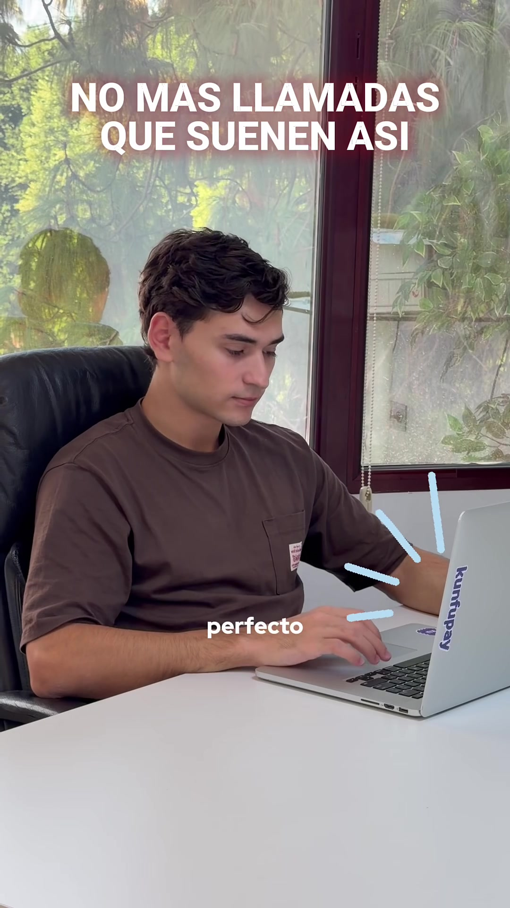
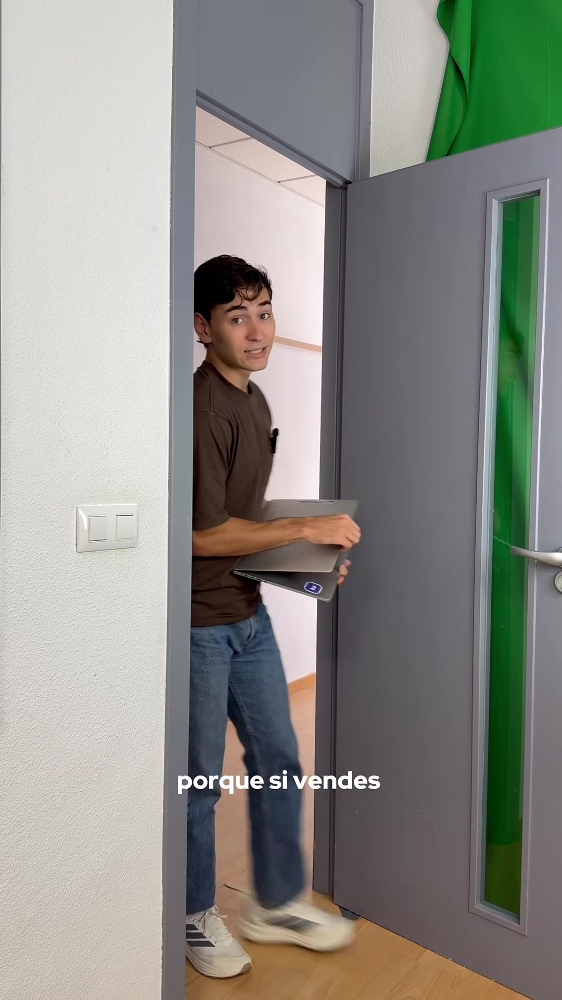
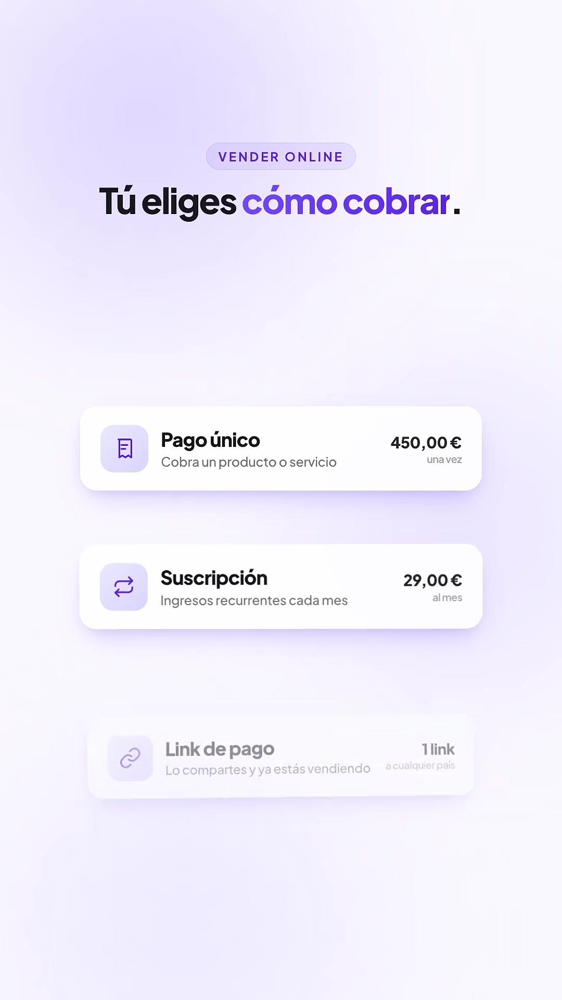
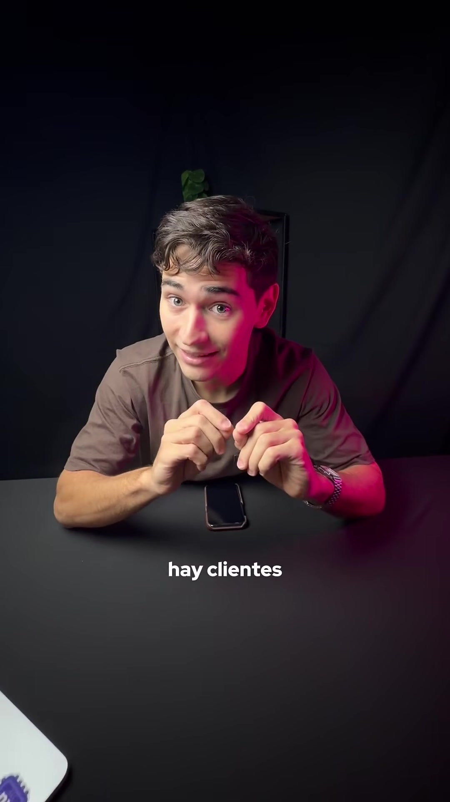
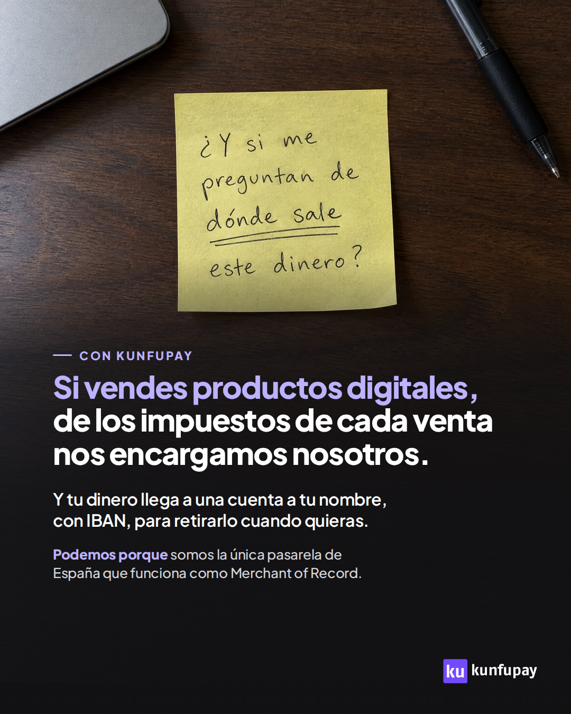
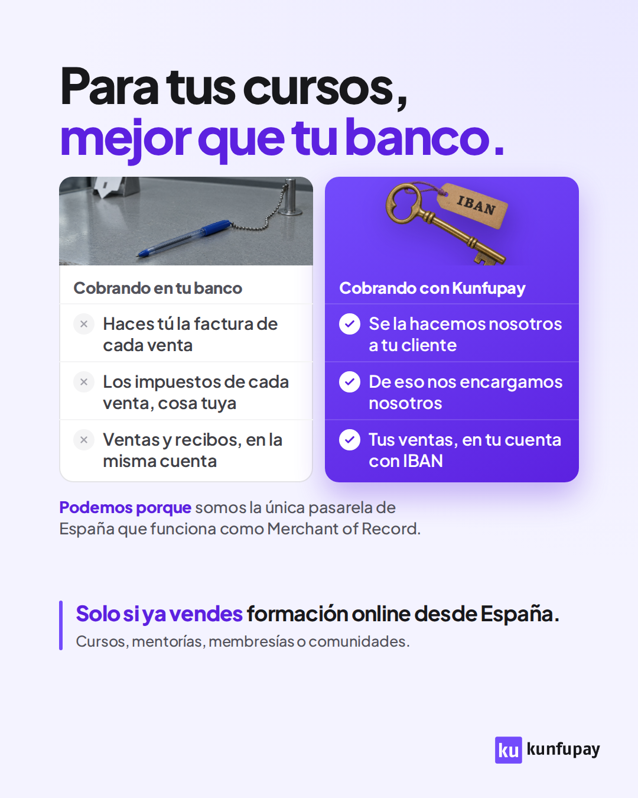
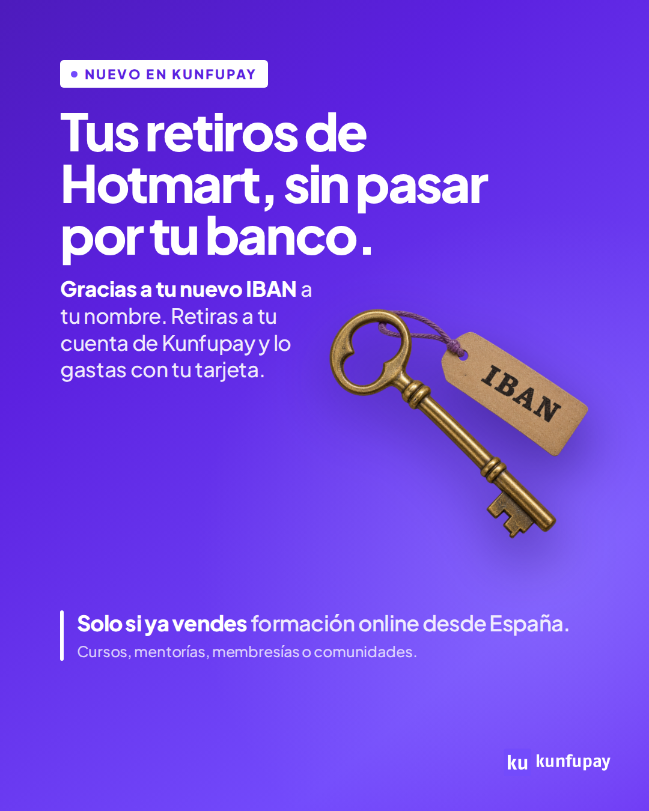
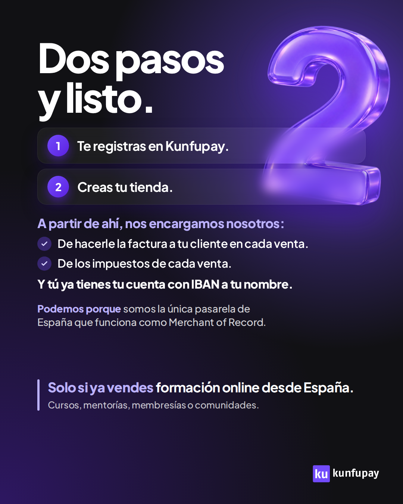
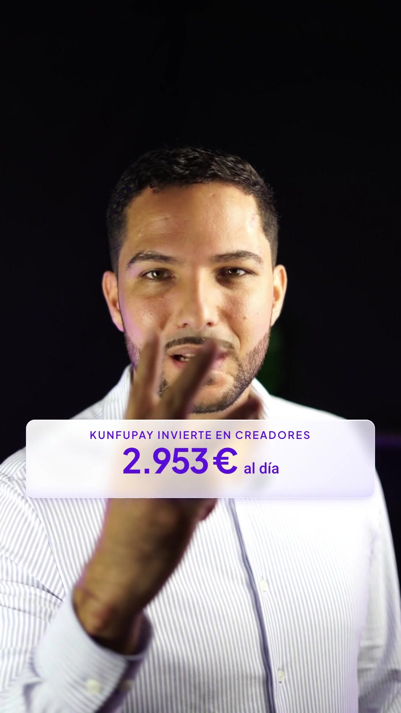

pie-pdf: Inventario de creatividades · Kunfupay
::portada Kunfupay · Marketing · Inventario | Inventario de creatividades | Todos los anuncios que tenemos, uno por uno: qué formato tienen, qué dicen, a qué parte del embudo hablan, en qué estado están y qué resultado han dado en Meta. | Versión del 13 de noviembre de 2026 · Acompaña al Documento maestro de creatividades
::indice

## Cómo leer el inventario || Qué significa cada columna y cada palabra

{lead} Este documento es una lista. Dice qué anuncios tenemos, cómo es cada uno y qué ha pasado con él en Meta.

No explica cómo se hace un anuncio ni por qué. Eso está en el Documento maestro y en las tres guías.

### Las columnas

| Columna | Qué pone |
|---|---|
| **Pieza** | El nombre de la pieza. Si está subida a Meta, su nombre allí |
| **Formato** | Si es una imagen (estático) o un vídeo (reel), y de qué tipo |
| **Qué dice** | La idea del anuncio en una frase. Va entre «» cuando es el texto tal cual |
| **Embudo** | A qué persona le habla: parte alta, media o baja |
| **Estado** | Cómo está hoy la pieza. Las palabras están explicadas más abajo |
| **Resultado en Meta** | Cuánto gastó, cuántos resultados trajo y a cuánto salió cada uno |

Los resultados son de los últimos 90 días: del 15 de agosto al 12 de noviembre de 2026. Los estados de Meta son los del 13 de noviembre.

### Las tres partes del embudo

<b>Alta</b>No sabe que tiene el problema, o lo acaba de notar. Le contamos el dolor, con una cifra.

<b>Media</b>Sabe que tiene el problema y busca cómo arreglarlo. Le contamos cómo funciona y contra qué se compara.

<b>Baja</b>Ya conoce Kunfupay o está listo para actuar. Le enseñamos la prueba y qué hacer ahora.

La parte del embudo no dice en qué campaña va el anuncio. Dice a qué persona le habla. Casi todas las piezas corren en campañas de público frío.

De dónde sale la parte del embudo de cada pieza:

- **Si el plan original le dio un nivel a la pieza, se usa ese nivel.** Niveles 1 y 2, parte alta. Nivel 3, media. Niveles 4 y 5, baja.
- **Si no tiene nivel, se asigna con la tabla de formatos del Documento maestro.** Tweet y comparativa, media. Noticia y cifra, alta. Página de pago, baja. Vídeo de dolor con filtro, alta. Vídeo que explica cómo funciona, media. Oferta y remarketing, baja.

La mayoría de las piezas de noviembre no tienen nivel escrito. En ellas, la parte del embudo es la de la tabla.

### Los estados

| Estado | Qué significa |
|---|---|
| **Activo** | Está en Meta y se está enseñando |
| **Pausado** | Está en Meta, pero parado: el anuncio, su conjunto o su campaña |
| **Archivado** | Se retiró de Meta. Quedan sus datos |
| **Borrador** | Está montado en Meta y no se ha publicado |
| **Hecha** | El archivo existe en el repositorio. No consta que se haya subido |
| **Escrito** | Es un guion. No consta que se haya grabado |
| **Por grabar** | El guion está y falta grabarlo |
| **Sustituido** | Se cambió por otra pieza |
| **Rechazado** | Meta no lo aprobó |

### El resultado en Meta

Tres cosas que hay que saber antes de leer una cifra:

1. **«Sin lectura»** quiere decir que el anuncio gastó menos de 36 €. Meta no lo enseñó lo suficiente. No sabemos si es bueno o malo. Entre paréntesis va lo que gastó.
2. **«No consta»** quiere decir que el anuncio no aparece en los datos de Meta de esos 90 días. O no se subió, o no gastó nada.
3. **Cada campaña cuenta un resultado distinto.** Por eso cada capítulo dice qué resultado se cuenta. No se comparan entre sí.

| Resultado | Qué es | Dónde se cuenta |
|---|---|---|
| **Registro** | Una cuenta creada en Kunfupay | Métodos de pago España y el conjunto antiguo de fiscal |
| **Lead** | Alguien que llega a la página de gracias | Hubs, los conjuntos nuevos de fiscal y Classroom Platinum |
| **Contacto** | Un clic en el WhatsApp de la página | Remarketing de vendedores |

> **Por qué 36 €:** es 3 veces el objetivo de 12 € por registro. Por debajo de eso no hay datos para juzgar un anuncio. Está explicado en la Guía 3.

Los datos salen de la cuenta de Meta: 450 anuncios con gasto y 20.993,39 € en los 90 días. Las cifras de un anuncio que está en varios conjuntos se dan por separado, o sumadas si cuentan el mismo resultado. Se dice en cada caso.

## Hubs: métodos de pago por lugar || LATAM, Miami, Dubái, Bali y Tailandia

{lead} Un hub es un sitio donde vive gente que habla español y vende por internet. Cada hub tiene su conjunto de anuncios, y sus piezas nombran el lugar.

En los hubs se cuenta el **lead**: alguien que llega a la página de gracias. Cada hub gasta 10 € al día. Los anuncios se subieron el 30 de octubre de 2026. Los de Tailandia, el 12 de noviembre.

| Hub | Piezas | Gasto | Leads | Coste por lead |
|---|---|---|---|---|
| **LATAM** | 5 estáticos y 6 reels | 131,17 € | 58 | 2,26 € |
| **Miami** | 5 estáticos y 5 reels | 106,51 € | 1 | 106,51 € |
| **Dubái** | 5 estáticos y 5 reels | 131,52 € | 4 | 32,88 € |
| **Bali** | 5 estáticos y 3 reels | 127,48 € | 6 | 21,25 € |
| **Tailandia** | 5 estáticos, 2 reels y 1 reel por grabar | 2,96 € | 1 | Sin lectura: lleva un día |

La gráfica del Documento maestro llega hasta el 11 de noviembre: por eso allí LATAM tiene 53 leads y aquí 58.

### Los estáticos: los mismos cinco formatos en cada hub

Cada hub lleva un tweet, una comparativa, una página de pago con flechas, una cifra «+30 %» y una noticia. Sus imágenes están en las páginas siguientes. En Meta se llaman siempre igual: FORMATO / TIPO / LUGAR. Por ejemplo, «ESTATICA / TWEET / LATAM» o «REEL / TRES COSAS / BALI». La cifra se llama allí «DESEO», y el reel propio de cada lugar, «PAGOS PERSONALIZADO».

### Los reels: cuatro genéricos y uno propio de cada lugar

<figure>

«¿Cómo te pago?»

«Ventas que pierdes»

«Infografía»

«Tres cosas»

Fiscal LATAM

Propio LATAM

Propio Miami

Propio Dubái

Propio Bali

<figcaption>Las portadas de los reels de los hubs. Los cuatro genéricos son el mismo vídeo en todos los hubs: solo cambia el texto del anuncio.</figcaption></figure>

| Reel | Qué dice | Embudo | Hubs que lo llevan |
|---|---|---|---|
| **«¿Cómo te pago?»** | Genérico. Cada «¿y cómo te pago?» es una venta que se puede caer | Alta | LATAM, Miami y Dubái |
| **«Ventas que pierdes»** | Genérico. «Hay ventas que pierdes sin darte cuenta»: hasta un 27 % | Alta | LATAM, Miami y Dubái |
| **«Infografía»** | Genérico, de pantallas. Creas un enlace y cada cliente paga con lo de su país | Media | Los cinco |
| **«Tres cosas»** | Genérico. Tres cosas que ya no necesitas para cobrar a varios países | Media | Los cinco |
| **Personalizado** | Uno por hub. El dolor con la cifra del 27 %, contado desde el lugar | Alta | Todos menos Tailandia, que está por grabar |
| **Fiscal** | De otro ángulo y con otra página: «no te montes una LLC» | Alta | Solo LATAM |

«¿Cómo te pago?» y «Ventas que pierdes» nombran la cripto: por eso no van en Bali ni en Tailandia. De «Tres cosas» y «Ventas que pierdes» no hay guion en el repositorio, solo sus textos de anuncio.

::salto

### LATAM

El ángulo: tus herramientas de cobro no pasan de la frontera. Conjunto «HUB LATAM / SIMILAR 3% HERNAN». Es el hub que más leads ha traído, y casi todos vienen de un anuncio.

::galeria creatividades/metodos-de-pago/hubs/estaticos/HUB-LATAM-E1_1080x1350.png = Tweet ; creatividades/metodos-de-pago/hubs/estaticos/HUB-LATAM-E2_1080x1350.png = Comparativa ; creatividades/metodos-de-pago/hubs/estaticos/HUB-LATAM-E3_1080x1350.png = Página de pago ; creatividades/metodos-de-pago/hubs/estaticos/HUB-LATAM-E4_1080x1350.png = Cifra «+30 %» ; creatividades/metodos-de-pago/hubs/estaticos/HUB-LATAM-E5_1080x1350.png = Noticia

#### Estáticos

| Pieza | Qué dice | Embudo | Estado | Resultado (leads) |
|---|---|---|---|---|
| **Tweet** | «Si vendes cursos desde Latinoamérica y cobras solo con tarjeta, estás perdiendo hasta un 27 %» | Media | Activo | Sin lectura (0,94 €) |
| **Comparativa** | «…esto pierdes cobrando solo con tarjeta.» Tabla de hoy frente a con Kunfupay | Media | Activo | Sin lectura (0,13 €) |
| **Página de pago** | «Estás perdiendo ventas.» Páginas de pago reales de Colombia y España | Baja | Activo | 97,08 € · 48 leads a 2,02 € |
| **Cifra «+30 %»** | «Podrías facturar hasta un 30 % más solo cambiando cómo cobras» | Alta | Activo | Sin lectura (0,12 €) |
| **Noticia** | «Creadores en LATAM ya aumentan su conversión un 27 %» | Alta | Activo | Sin lectura (0,17 €) |

#### Reels

| Pieza | Qué dice | Embudo | Estado | Resultado (leads) |
|---|---|---|---|---|
| **«¿Cómo te pago?»** | El vídeo genérico. Solo cambia el texto | Alta | Activo | Sin lectura (0,22 €) |
| **«Ventas que pierdes»** | El vídeo genérico. Solo cambia el texto | Alta | Activo | Sin lectura (0,01 €) |
| **«Infografía»** | El vídeo genérico. Solo cambia el texto | Media | Activo | Sin lectura (22,23 €, 7 leads) |
| **«Tres cosas»** | El vídeo genérico. Solo cambia el texto | Media | Activo | Sin lectura (8,87 €, 2 leads) |
| **Personalizado** | Cobrar con Hotmart, con Stripe a través de una LLC o por transferencia «no escala» | Alta | Activo | Sin lectura (0,10 €) |
| **Fiscal** | «Si vendes cursos desde LATAM, no te montes una LLC» | Alta | Activo | Sin lectura (1,30 €, 1 lead) |

::salto

### Miami

El ángulo: lo de allí no entra aquí. Tu Stripe de Estados Unidos no cobra lo que usa tu cliente de Colombia o México. Tiene campaña propia y el conjunto «HUB MIAMI / ZONA LATINA HIALEAH-DORAL». Ojo: la noticia lleva los logos de Stripe y PayPal tachados, y el Documento maestro pide no repetirlo.

::galeria creatividades/metodos-de-pago/hubs/estaticos/HUB-MIA-E1_1080x1350.png = Tweet ; creatividades/metodos-de-pago/hubs/estaticos/HUB-MIA-E2_1080x1350.png = Comparativa ; creatividades/metodos-de-pago/hubs/estaticos/HUB-MIA-E3_1080x1350.png = Página de pago ; creatividades/metodos-de-pago/hubs/estaticos/HUB-MIA-E4_1080x1350.png = Cifra «+30 %» ; creatividades/metodos-de-pago/hubs/estaticos/HUB-MIA-E5_1080x1350.png = Noticia

#### Estáticos

| Pieza | Qué dice | Embudo | Estado | Resultado (leads) |
|---|---|---|---|---|
| **Tweet** | «Si vendes cursos desde Miami y cobras con Stripe, estás perdiendo hasta un 27 %» | Media | Activo | Sin lectura (7,59 €) |
| **Comparativa** | «…esto te cuesta cobrar solo con Stripe.» Tabla de hoy frente a con Kunfupay | Media | Activo | Sin lectura (0,23 €) |
| **Página de pago** | «Ya no cobres a LATAM con Stripe.» Páginas de pago reales de Colombia y México | Baja | Activo | Sin lectura (3,28 €) |
| **Cifra «+30 %»** | «Podrías facturar hasta un 30 % más.» «Que te pague cualquier cliente de LATAM» | Alta | Activo | Sin lectura (0,78 €) |
| **Noticia** | «Creadores en Miami ya aumentan su conversión un 27 %» | Alta | Activo | 45,68 € · 0 leads |

#### Reels

| Pieza | Qué dice | Embudo | Estado | Resultado (leads) |
|---|---|---|---|---|
| **«¿Cómo te pago?»** | El vídeo genérico. Solo cambia el texto | Alta | Activo | Sin lectura (0,07 €) |
| **«Ventas que pierdes»** | El vídeo genérico. Solo cambia el texto | Alta | Activo | Sin lectura (2,11 €) |
| **«Infografía»** | El vídeo genérico. Solo cambia el texto | Media | Activo | 42,63 € · 0 leads |
| **«Tres cosas»** | El vídeo genérico. Solo cambia el texto | Media | Activo | Sin lectura (0,14 €) |
| **Personalizado** | «Tu cliente de LATAM te dijo que sí en la llamada. Abrió tu Stripe. Y no pudo pagarte» | Alta | Activo | Sin lectura (4,00 €, 1 lead) |

::salto

### Dubái

El ángulo: España te compra por la mañana y LATAM por la noche. Conjunto «HUB DUBAI / SIMILAR 3% HERNAN». La noticia, que es el anuncio que más ha gastado aquí, también lleva los logos de Stripe y PayPal tachados.

::galeria creatividades/metodos-de-pago/hubs/estaticos/HUB-DXB-E1_1080x1350.png = Tweet ; creatividades/metodos-de-pago/hubs/estaticos/HUB-DXB-E2_1080x1350.png = Comparativa ; creatividades/metodos-de-pago/hubs/estaticos/HUB-DXB-E3_1080x1350.png = Página de pago ; creatividades/metodos-de-pago/hubs/estaticos/HUB-DXB-E4_1080x1350.png = Cifra «+30 %» ; creatividades/metodos-de-pago/hubs/estaticos/HUB-DXB-E5_1080x1350.png = Noticia

#### Estáticos

| Pieza | Qué dice | Embudo | Estado | Resultado (leads) |
|---|---|---|---|---|
| **Tweet** | «Si vendes cursos desde Dubái y cobras con Stripe, estás perdiendo hasta un 27 %» | Media | Activo | Sin lectura (1,12 €) |
| **Comparativa** | «Si cobras con un Stripe de Emiratos, pierdes hasta un 27 % de tus ventas.» Tabla de métodos | Media | Activo | Sin lectura (0,50 €) |
| **Página de pago** | «Ya no cobres a España y LATAM con Stripe.» Páginas de pago reales de México y España | Baja | Activo | Sin lectura (1,92 €) |
| **Cifra «+30 %»** | «España por la mañana, LATAM por la noche: todos pueden pagarte» | Alta | Activo | Sin lectura (0,13 €) |
| **Noticia** | «Creadores en Dubái ya aumentan su conversión un 27 %» | Alta | Activo | 89,47 € · 4 leads a 22,37 € |

#### Reels

| Pieza | Qué dice | Embudo | Estado | Resultado (leads) |
|---|---|---|---|---|
| **«¿Cómo te pago?»** | El vídeo genérico. Solo cambia el texto | Alta | Activo | Sin lectura (3,30 €) |
| **«Ventas que pierdes»** | El vídeo genérico. Solo cambia el texto | Alta | Activo | Sin lectura (2,69 €) |
| **«Infografía»** | El vídeo genérico. Solo cambia el texto | Media | Activo | Sin lectura (25,83 €) |
| **«Tres cosas»** | El vídeo genérico. Solo cambia el texto | Media | Activo | Sin lectura (3,39 €) |
| **Personalizado** | «No necesitas un Rolex ni un deportivo para vender más desde Dubái» | Alta | Activo | Sin lectura (3,17 €) |

::salto

### Bali

El ángulo: tú duermes y tus clientes pagan. Conjunto «HUB BALI / SIMILAR 3% HERNAN». Ninguna pieza nombra la cripto: en Indonesia está prohibida como medio de pago.

::galeria creatividades/metodos-de-pago/hubs/estaticos/HUB-BALI-E1_1080x1350.png = Tweet ; creatividades/metodos-de-pago/hubs/estaticos/HUB-BALI-E2_1080x1350.png = Comparativa ; creatividades/metodos-de-pago/hubs/estaticos/HUB-BALI-E3_1080x1350.png = Página de pago ; creatividades/metodos-de-pago/hubs/estaticos/HUB-BALI-E4_1080x1350.png = Cifra «+30 %» ; creatividades/metodos-de-pago/hubs/estaticos/HUB-BALI-E5_1080x1350.png = Noticia

#### Estáticos

| Pieza | Qué dice | Embudo | Estado | Resultado (leads) |
|---|---|---|---|---|
| **Tweet** | «Si vendes cursos desde Bali y cobras con Stripe o PayPal, estás perdiendo hasta un 27 %» | Media | Activo | Sin lectura (1,56 €, 1 lead) |
| **Comparativa** | «Si das sesiones 1:1 desde Bali, esto pierdes cobrando solo con PayPal» | Media | Activo | Sin lectura (2,56 €) |
| **Página de pago** | «Ya no cobres a España y LATAM con Stripe.» Páginas de pago reales de México y España | Baja | Activo | Sin lectura (18,99 €) |
| **Cifra «+30 %»** | «Mientras duermes, tus clientes te pagan» | Alta | Activo | Sin lectura (0,71 €) |
| **Noticia** | «Creadores en Bali ya aumentan su conversión un 27 %» | Alta | Activo | Sin lectura (21,88 €, 2 leads) |

#### Reels

| Pieza | Qué dice | Embudo | Estado | Resultado (leads) |
|---|---|---|---|---|
| **«Infografía»** | El vídeo genérico. Solo cambia el texto | Media | Activo | Sin lectura (9,34 €) |
| **«Tres cosas»** | El vídeo genérico. Solo cambia el texto | Media | Activo | Sin lectura (9,75 €) |
| **Personalizado** | «Tu cliente de España dijo que sí. PayPal dijo que no» | Alta | Activo | 62,69 € · 3 leads a 20,90 € |

El reel personalizado es el anuncio con más gasto de Bali. Un detalle de la subida: la página de pago de Bali solo tiene cargada la imagen de feed, así que en Stories sale la versión 4:5. La imagen vertical existe en el repositorio.

::salto

### Tailandia

El ángulo: de madrugada aquí, de día en LATAM, y te pagan igual. Es el hub más nuevo. Desde el 12 de noviembre corre en la campaña «ADQUISICIÓN / KUNFUPAY / 12112026», en el conjunto «HUB TAILANDIA / BANGKOK / AUD HERNAN». Sin cripto, como Bali.

::galeria creatividades/metodos-de-pago/hubs/estaticos/HUB-TAILANDIA-E1_1080x1350.png = Tweet ; creatividades/metodos-de-pago/hubs/estaticos/HUB-TAILANDIA-E2_1080x1350.png = Comparativa ; creatividades/metodos-de-pago/hubs/estaticos/HUB-TAILANDIA-E3_1080x1350.png = Página de pago ; creatividades/metodos-de-pago/hubs/estaticos/HUB-TAILANDIA-E4_1080x1350.png = Cifra «+30 %» ; creatividades/metodos-de-pago/hubs/estaticos/HUB-TAILANDIA-E5_1080x1350.png = Noticia

#### Estáticos

| Pieza | Qué dice | Embudo | Estado | Resultado (leads) |
|---|---|---|---|---|
| **Tweet** | «Si vendes cursos desde Tailandia y cobras con Stripe o PayPal, estás perdiendo hasta un 27 %» | Media | Activo | Sin lectura (0,28 €) |
| **Comparativa** | «Si vendes tu mentoría desde Tailandia, esto pierdes cobrando solo con tarjeta» | Media | Activo | Sin lectura (0,25 €) |
| **Página de pago** | Es la de Bali cambiando la primera línea: «Si vendes cursos desde Tailandia» | Baja | Activo | Sin lectura (1,07 €) |
| **Cifra «+30 %»** | «De madrugada aquí, de día en LATAM: te pagan igual» | Alta | Borrador | No consta |
| **Noticia** | «Creadores que venden a España y LATAM ya aumentan su conversión un 27 %» | Alta | Activo | Sin lectura (1,36 €, 1 lead) |

#### Reels

| Pieza | Qué dice | Embudo | Estado | Resultado (leads) |
|---|---|---|---|---|
| **«Infografía»** | El vídeo genérico. Solo cambia el texto | Media | Borrador | No consta |
| **«Tres cosas»** | El vídeo genérico. Solo cambia el texto | Media | Borrador | No consta |
| **Personalizado** | «Son las tres de la madrugada en Bangkok. En México, las dos de la tarde» | Alta | Por grabar | No consta |

En Meta, los cuatro estáticos activos llevan la fecha al final del nombre («… / TAILANDIA / 12112026»). La cifra y los dos reels figuraban en borrador el 12 de noviembre y no aparecen en los datos. La noticia no dice «Creadores en Tailandia» porque no tenemos clientes allí.

## Métodos de pago · España || Cinco estáticos nuevos, cuatro de octubre y los vídeos

{lead} Es el mismo ángulo que los hubs, para quien vende desde España a alumnos de Latinoamérica.

Está en la campaña de testeo de España, en el conjunto «METODOS DE PAGO / ESP / AUD HERNAN 1%». Aquí se cuenta el **registro**: una cuenta creada. En 90 días el conjunto gastó 1.139,63 € y trajo 25 registros, a 45,59 € cada uno.

El 12 de noviembre el conjunto se copió a la campaña nueva «ADQUISICIÓN / KUNFUPAY / 12112026», que cuenta leads. Esa copia lleva un día y 16,68 € entre sus 10 anuncios: está sin lectura y no se desglosa aquí.

### Los estáticos

Primera fila, los cinco de noviembre. Segunda fila, los cuatro de octubre y la portada del reel.

::galeria creatividades/metodos-de-pago/espana/estaticos/ES-E1_1080x1350.png = Tweet ; creatividades/metodos-de-pago/espana/estaticos/ES-E2_1080x1350.png = Comparativa ; creatividades/metodos-de-pago/espana/estaticos/ES-E3_1080x1350.png = Página de pago ; creatividades/metodos-de-pago/espana/estaticos/ES-E4_1080x1350.png = Cifra «+30 %» ; creatividades/metodos-de-pago/espana/estaticos/ES-E5_1080x1350.png = Noticia
::galeria creatividades/metodos-de-pago/KFP_ES_TOF_ABR_B01-CRIPTOAEUROS_MONEDAS_1080x1350_ES_V01.png = B-01 · Monedas ; creatividades/metodos-de-pago/KFP_ES_TOF_CLO_B02-UNSOLOENLACE_FLUJO_1080x1350_ES_V02.png = B-02 · Flujo ; creatividades/metodos-de-pago/KFP_ES_TOF_PRO_B05-MISMOENLACE_MAPA_1080x1350_ES_V02.png = B-05 · Mapa ; creatividades/metodos-de-pago/KFP_ES_TOF_PRO_B09-ESTUCHECUCHILLOS_MEME_1080x1350_ES_V03.png = B-09 · Meme ; creatividades/metodos-de-pago/portadas/reel-deja-de-perder-ventas.jpg = Reel «Deja de perder ventas»

| Pieza, formato y nombre en Meta | Qué dice | Embudo | Estado | Resultado (registros) |
|---|---|---|---|---|
| **Tweet** (ES-E1). Estático: tweet de Rubén | «Si vendes cursos desde España y cobras con Stripe, estás perdiendo hasta un 27 % de tu facturación» | Media | Hecha. No consta subida | No consta |
| **Comparativa** (ES-E2). Estático: tabla «Hoy, con Stripe / Con Kunfupay» | «Deja de perder ventas cobrando solo con Stripe» | Media | Hecha. No consta subida | No consta |
| **Página de pago** (ES-E3) · ESTATICA / PAGINA DE PAGO / ESP. Estático: capturas reales con flechas | «Deja de perder ventas cobrando a LATAM solo con Stripe.» «Y tú recibes euros» | Baja | Activo | 162,13 € · 6 registros a 27,02 € |
| **Cifra «+30 %»** (ES-E4). Estático: cifra sobre fondo oscuro | «Podrías facturar hasta un 30 % más. Sin vender más. Solo cambiando cómo cobras» | Alta | Hecha. No consta subida | No consta |
| **Noticia** (ES-E5). Estático: foto de Madrid y banda «Actualidad» | «Creadores en España ya aumentan su conversión un 27 %» | Alta | Hecha. No consta subida | No consta |
| **B-01 «Cripto a euros»** · B-01 · N1 · Dolor · Cliente con cripto. Estático: dos monedas | «Si vendes cursos en Hotmart, no pierdas ventas porque tu cliente tiene el dinero en cripto» | Alta | Pausado | Sin lectura (7,92 €) |
| **B-02 «Un solo enlace»** · B-02 · N2 · Mecanismo · Mil formas de cobrar. Estático: flujo de arriba abajo | Hoy necesitas tres herramientas para cobrar. Con Kunfupay, un solo enlace | Alta | Pausado | Sin lectura (9,93 €) |
| **B-05 «El mismo enlace»** · B-05 · N3 · Mecanismo · Alumnos en LATAM. Estático: mapa | «Cóbrales a tus alumnos de Latinoamérica con el mismo enlace» | Media | Activo | 249,61 € · 4 registros a 62,40 € |
| **B-09 «El estuche de cuchillos»**. Estático: meme | Seis cuchillos con etiqueta frente a uno solo: «un solo enlace» | Alta | Hecha. Es una pieza extra, de relevo | No consta |
| IMG / TWEET PAGO GLOBAL. Estático: tweet | No consta. No hay imagen en el repositorio | Media | Activo | 46,58 € · 0 registros |

En Meta, los nombres de las piezas de octubre llevan barras verticales. Aquí van como puntos.

### Los vídeos

| Pieza, formato y nombre en Meta | Qué dice | Embudo | Estado | Resultado (registros) |
|---|---|---|---|---|
| **«Deja de perder ventas»** · REEL / DEJA DE PERDER VENTAS / MET PAGOS. Reel, solo Instagram | «No es tu oferta, es cómo te pagan.» Puedes estar perdiendo hasta un 30 % de tus ventas | Alta | Activo | Sin lectura (20,54 €, 1 registro) |
| REEL / NI SKOOL NI STRIPE / MÉTODOS DE PAGO / ESP. Reel | Lo que usas hoy no cobra a todos tus alumnos | Media | Activo | 70,59 € · 2 registros a 35,30 € |
| REEL / KUNFUPAY EN SKOOL / MÉTODOS DE PAGO / ESP. Reel | La misma entrada, para quien usa Skool. El guion no consta | Media | Activo | Sin lectura (18,34 €) |
| B-V1 · Infografía · Cobros en la app. Reel de pantallas, sin cara | Cómo se cobra con Kunfupay, paso a paso | Media | Activo | 407,55 € · 10 registros a 40,76 € |
| MP-C1 · Vídeo · Un solo enlace. Vídeo por piezas: cuerpo 1 | La venta que se enfría: el cliente dice «luego lo miro» | Alta | Activo | 38,87 € · 1 registro a 38,87 € |
| MP-C2 · Vídeo · Ventas que pierdes. Vídeo por piezas: cuerpo 2 | Tu cliente quiere comprar y no puede pagarte con lo que tiene | Alta | Pausado | 41,83 € · 0 registros |
| MP-C3 · Vídeo · Todo en un enlace. Vídeo por piezas: cuerpo 3 | Demasiadas formas de cobrar: todo cabe en un enlace | Alta | Activo | 65,74 € · 1 registro a 65,74 € |
| **Guion por piezas**: 3 cuerpos y 10 ganchos. Guion | Cada gancho acaba en una venta que se pierde al pagar | Alta | Escrito el 6 de octubre | De los ganchos sueltos no consta |

MP-C1, MP-C2 y MP-C3 se cruzan con los cuerpos 1, 2 y 3 del guion por su código. En el guion, el cuerpo 2 se llama «Con lo que tiene», no «Ventas que pierdes». El plan de octubre nombra además un «vídeo animado del flujo» que no está en el repositorio.

> **Dos cosas a revisar:** el reel «Deja de perder ventas» dice que se pierde «hasta un 30 %», cuando el resto de piezas dice «hasta un 27 %». Y la noticia de España lleva la foto de Rubén borrosa: la de Tailandia ya se rehízo con la foto buena.

## Optimización fiscal || Un estático, cuatro reels de noviembre y los vídeos que más registros dan

{lead} Para el autónomo que vende formación online desde España. La promesa: la factura y los impuestos de cada venta dejan de ser cosa tuya.

Los anuncios de fiscal están en tres conjuntos de la campaña de testeo de España. Cada uno cuenta una cosa:

- **«OPTIMIZACION FISCAL / ESP»**: cuenta registros. Es el antiguo y está pausado.
- **«… / AUD HERNAN 3% / LANDING / ESP»**: cuenta leads de la página de gracias. Activo.
- **«… / AUD RUBEN 1% / 09112026»**: cuenta leads. Activo desde el 9 de noviembre.

### Lo que hay en el repositorio

::galeria creatividades/optimizacion-fiscal/KFP_ES_TOF_CLO_A01-STRIPEOKUNFUPAY_COMPARATIVA_1080x1350_ES_V02.png = A-01 «Stripe o Kunfupay» ; creatividades/optimizacion-fiscal/portadas/reel-jorge-gpt.jpg = Reel «Jorge GPT» ; creatividades/optimizacion-fiscal/portadas/reel-benja-30-mor.jpg = Reel «Benja» ; creatividades/optimizacion-fiscal/portadas/reel-ruben-ahorro-imp.jpg = Reel «Rubén ahorro» ; creatividades/optimizacion-fiscal/portadas/reel-ruben-producto.jpg = Reel «Rubén producto»
| Pieza, formato y nombre en Meta | Qué dice | Embudo | Estado | Resultado (leads) |
|---|---|---|---|---|
| **A-01 «Stripe o Kunfupay»** · A-01 · N2 · Comparativa · Cobra con Stripe. Estático: comparativa a dos columnas | Cobras igual que con Stripe, pero la factura y los impuestos de cada venta dejan de ser tuyos | Alta | Pausado | Sin lectura (13,47 €, 1 lead) |
| REEL / JORGE GPT / FISCAL. Reel: equipo a cámara | Se lo preguntó a ChatGPT y la respuesta fue «Utiliza un Merchant of Record» | Media | Activo | Sin lectura (5,34 €) |
| REEL / BENJA 30 % MOR / FISCAL. Reel: equipo a cámara | «¿Eres autónomo y vendes online?» Somos tus representantes en cada venta | Media | Activo | Sin lectura (1,95 €) |
| REEL / RUBEN AHORRO IMP / FISCAL. Reel: equipo a cámara | Antes de montar una LLC o irte a Dubái o Andorra: lo que buscas no exige irte | Alta | Activo | Sin lectura (6,83 €) |
| REEL / RUBEN PRODUCTO / FISCAL. Reel: equipo a cámara | IVA, facturas, trimestres: hay otra forma sin irte de España | Alta | Activo | Sin lectura (3,80 €) |
| **Guion 1 · LLC**. Guion por piezas | «Con Kunfupay ya no necesitas montarte una LLC» | Alta | Escrito | No consta |
| **Guion 2 · Impuestos y facturas**. Guion por piezas | «Los impuestos y las facturas de cada venta dejan de ser cosa tuya» | Alta | Pendiente de escribir | No consta |
| **Guion 3 · Merchant of Record**. Guion por piezas | Cómo funciona: somos tus representantes en cada venta | Media | Pendiente de escribir | No consta |

Los cuatro reels se subieron el 3 de noviembre a un conjunto que ya tenía ganador. Por eso casi no gastaron: es la regla 11 del Documento maestro. El estático A-01 gastó además 2,26 € en el conjunto antiguo, sin registros.

### Los demás anuncios de fiscal que están en Meta

No tienen archivo en el repositorio. Son los que más han gastado. Cada uno tiene dos resultados porque estuvo en conjuntos que cuentan cosas distintas: no se comparan las dos columnas.

| Anuncio en Meta | Qué es | Embudo | Estado | A registro (conjunto antiguo) | A lead (conjuntos nuevos) |
|---|---|---|---|---|---|
| REEL / Profitstride - FISCAL | Reel fiscal. El que más registros ha dado | No consta | Activo | 874,14 € · 66 registros a 13,24 € | 422,25 € · 1 lead a 422,25 € |
| REEL PODCAST JUANEN | Reel: un trozo de una conversación sobre fiscal | No consta | Activo | 191,53 € · 25 registros a 7,66 € | 828,41 € · 24 leads a 34,52 € |
| A-V5 · Contraste · Miami y Murcia | Vídeo: vender tus cursos «como si estuvieras en Miami», sin moverte de Murcia | No consta | Activo | Sin lectura (2,75 €) | 590,20 € · 22 leads a 26,83 € |
| A-V8 · Explicativo · MoR no es magia | Vídeo: «Un Merchant of Record no es magia» | Media | Activo | Sin lectura (35,41 €) | Sin lectura (19,33 €, 3 leads) |
| A-V7 · Creencia · Dubái o Andorra | Vídeo: no hace falta irse a Dubái ni a Andorra | Alta | Pausado | Sin lectura (21,72 €, 2 registros) | — |
| A-V3 · Historia · El lanzamiento | Vídeo: la cuenta que llega tres meses después del lanzamiento | Alta | Archivado | Sin lectura (1,63 €) | — |
| REEL / LLC ESPAÑA 2 | Reel sobre la LLC | No consta | Archivado | 68,96 € · 3 registros a 22,99 € | — |
| REEL / LLC RUBEN EEUU | Reel sobre la LLC, con Rubén | No consta | Pausado | Sin lectura (28,54 €, 5 registros) | — |
| REEL / LLC ESPAÑA | Reel sobre la LLC | No consta | Pausado | Sin lectura (22,12 €, 2 registros) | — |

En «Estado» pone «Activo» si el anuncio sigue activo en alguno de los conjuntos nuevos.

- Los mismos anuncios estuvieron también en el conjunto «OPTIMIZACION FISCAL / ESP / ANDROMEDA», ya pausado. Gastó 121,12 € en total. De ellos, 110,01 € fueron de «Profitstride», con 1 registro.
- Los 5 estáticos fiscales antiguos están en «Piezas antiguas o sustituidas».

> **Lo que se ve aquí:** «Profitstride» es el mejor anuncio de la cuenta cuando se cuentan registros, y casi no trae leads cuando se cuenta la página de gracias. Un anuncio puede ganar con un objetivo y perder con otro.

## Cuenta a tu nombre (IBAN) || Cuatro estáticos hechos y un guion por piezas

{lead} Para quien cobra de plataformas y recibe ese dinero en su banco personal. La promesa: una cuenta a tu nombre, con IBAN y tarjeta, para tus cobros.

De esta línea no hay ningún dato de Meta. Ninguna de sus piezas aparece con su nombre en los 90 días. En el plan, el conjunto contaba registros y tenía 20 € al día para 8 anuncios.

<figure>

D-01 · Nota a boli

D-02 · Comparativa

D-05 · Noticia

D-08 · Oferta

</figure>

| Pieza, formato y nombre previsto en Meta | Qué dice | Embudo | Estado | Resultado |
|---|---|---|---|---|
| **D-01** · D-01 · N1 · Miedo · Justificar ingresos. Estático: nota escrita a boli | «¿Y si me preguntan de dónde sale este dinero?» | Alta | Hecha. Va por la versión 5 | No consta |
| **D-02** · D-02 · N2 · Comparativa · Banco de siempre. Estático: comparativa a dos columnas | «Para tus cursos, mejor que tu banco» | Alta | Hecha. Versión 4 | No consta |
| **D-05** · D-05 · N4 · Novedad · Vende en Hotmart. Estático: noticia con etiqueta | «Tus retiros de Hotmart, sin pasar por tu banco» | Baja | Hecha. Versión 4 | No consta |
| **D-08** · D-08 · N5 · Oferta · Listo. Estático: oferta | «Dos pasos y listo»: te registras y creas tu tienda | Baja | Hecha. Versión 4 | No consta |
| **3 cuerpos**: «Los impuestos primero», «El dinero primero» y «Sin montar nada». Guion por piezas, de 35 a 45 segundos | Uno por cada dolor: el miedo a los impuestos, el dinero parado y las dudas | Alta | Escritos | No consta |
| **12 ganchos** (1A a 1E, 2A a 2C y 3A a 3D). Ganchos de 3 a 8 segundos | Cada uno abre con un dolor de su familia | Alta | Escritos | No consta |

- Cada estático existe en dos tamaños: 1080×1350 y 1080×1920.
- En Meta hay un conjunto «WALLET / ESP / ANDROMEDA», pausado, con 6 anuncios y 4,34 € de gasto entre todos. Sus nombres no coinciden con estas piezas, así que no se cruzan.

- **A revisar antes de subir D-05:** su titular dice «sin pasar por tu banco», una frase que el Documento maestro da por descartada. Hoy se dice «a tu nombre y en regla».
- El plan preveía además 4 vídeos (guiones 9, 4, 6 y 2). No están en el repositorio.

## Classroom Platinum || Dos reels en el repositorio y lo que hay en Meta

{lead} Para el creador que ya vende formación, tiene audiencia y factura. La promesa: ponemos dinero en anuncios, equipo y plataforma.

Aquí se cuenta el **lead**: alguien que llega a la página de gracias después de aplicar. En 90 días hubo 31 anuncios distintos (64 contando sus copias en varios conjuntos). Gastaron 6.447,99 € y trajeron 145 leads, a 44,47 € cada uno.

Los documentos de Classroom no dan nivel a ninguna pieza. La parte del embudo de este capítulo sale de la tabla de formatos.

### Lo que hay en el repositorio

<figure>

Reel «VC Money», con Cristian

Reel «Inversión», con Rubén

<figcaption>Las dos portadas que hay en el repositorio. De Classroom Platinum no hay estáticos guardados.</figcaption></figure>

| Pieza, formato y nombre en Meta | Qué dice | Embudo | Estado | Resultado (leads) |
|---|---|---|---|---|
| REEL / VC MONEY / CRISTIAN. Reel con 5 textos y 5 títulos | «¿Y si tuvieras presupuesto ilimitado para anuncios?» Ponemos dinero, plataforma y equipo | Baja | Activo | 117,35 € · 3 leads a 39,12 € |
| REEL / INVERSION / RUBEN. Reel con 5 textos y 5 títulos | Kunfupay invierte más de 1.000.000 € al año en creadores y busca a los siguientes | Baja | Activo | 166,90 € · 1 lead a 166,90 € |
| **Cuerpo 1 · Dinero**. Guion por piezas | «Vamos a poner dinero en ti» | Baja | Grabado, con los ganchos «REEL / 1» a «REEL / 4» | Ver «REEL / 1» a «REEL / 4» en la tabla siguiente |
| **Cuerpo 2 · Acompañamiento**. Guion por piezas | «No solo dinero: un equipo que te acompaña» | Media | Por grabar el 13 de octubre | No consta |
| **Cuerpo 3 · Metodología**. Guion por piezas, con un mapa de 4 fases | «Seis meses. Cuatro fases» | Media | Por grabar el 13 de octubre | No consta |

En Meta hay anuncios llamados «REEL / HOOK 1 / CUERPO 2» y «REEL / HOOK 2 / CUERPO 2», del 19 de octubre. No consta si ese «cuerpo 2» es el de acompañamiento.

### Los anuncios que están en Meta

Las cifras suman las copias del mismo anuncio en todos sus conjuntos. De estos anuncios, salvo los dos reels de arriba, no hay archivo en el repositorio: la columna «Qué es» sale solo del nombre.

| Anuncio en Meta | Qué es | Embudo | Estado | Resultado (leads) |
|---|---|---|---|---|
| IMG / TWEET CLASSROOM | Estático: tweet | Media | Activo | 1.835,95 € · 25 leads a 73,44 € |
| IMG / VIDEOJUEGO CLASSROOM | Estático: mapa de niveles, como un videojuego | No consta | Pausado | 1.352,91 € · 53 leads a 25,53 € |
| IMG / Hormozi Ataud | Estático | No consta | Activo | 969,50 € · 19 leads a 51,03 € |
| RUBEN PIZARRA / CLASSROOM - SIMILAR | Reel: Rubén con una pizarra | Media | Pausado | 345,42 € · 9 leads a 38,38 € |
| REEL / 1 | Reel: gancho 1 con el cuerpo de dinero | Baja | Activo | 334,07 € · 5 leads a 66,81 € |
| REEL / INVERSION / RUBEN | Reel: equipo a cámara | Baja | Activo | 166,90 € · 1 lead a 166,90 € |
| IMG / Noticia Ruben | Estático: noticia | Alta | Activo | 162,65 € · 2 leads a 81,33 € |
| REEL / HOOK 2 / CUERPO 1 | Reel: prueba de gancho y cuerpo | No consta | Pausado | 123,74 € · 1 lead a 123,74 € |
| REEL / LOOM | Reel | No consta | Activo | 123,14 € · 1 lead a 123,14 € |
| RUBEN_HORMOZI | Reel con Rubén | No consta | Pausado | 121,43 € · 3 leads a 40,48 € |
| 3 22 / RUBEN & MJ / CLASROOM | Reel con Rubén y MJ | No consta | Pausado | 119,63 € · 4 leads a 29,91 € |
| REEL / VC MONEY / CRISTIAN | Reel: equipo a cámara | Baja | Activo | 117,35 € · 3 leads a 39,12 € |
| REEL / HOOK 2 / CUERPO 2 | Reel: prueba de gancho y cuerpo | No consta | Activo | 113,23 € · 1 lead a 113,23 € |
| REEL / PING PONG | Reel | No consta | Activo | 108,66 € · 1 lead a 108,66 € |
| RUBEN PIZARRA / CLASSROOM | Reel: Rubén con una pizarra | Media | Pausado | 89,80 € · 1 lead a 89,80 € |
| 3 22 RUBEN CLASROOM | Reel con Rubén | No consta | Pausado | 83,56 € · 9 leads a 9,28 € |
| IMG / MOSSERI CLASSROOM | Estático | No consta | Pausado | 54,17 € · 3 leads a 18,06 € |
| REEL / 2 | Reel: gancho 2 con el cuerpo de dinero | Baja | Activo | 45,91 € · 1 lead a 45,91 € |
| Otros 13 anuncios | Estáticos y reels con menos de 36 € cada uno | No consta | Pausados, salvo «REEL / 3» | Sin lectura (179,97 € entre todos, 3 leads) |

### Otros conjuntos de la misma campaña

- **«CLASSROOM / REGISTRO / ESP»**, activo: 8 reels sobre pasar de Skool a Classroom. Cuenta leads cualificados de Classroom: 714,30 € y 10 leads, a 71,43 €.
- **«FORM CREATOR BUSINESS SCORE»**, pausado: 12 anuncios del test «Score». Cuenta leads del formulario de Meta: 324,91 € y 13 leads, a 24,99 €.
- **«ANDROMEDA CREATOR BUSINESS SCORE»**, pausado: los mismos 12, llevando a la página. 88,25 € y 0 resultados.

En el primero, el anuncio que más gastó es «REEL / SKOOL+STRIPE=PROBLEMAS»: 418,90 € y 5 leads cualificados, a 83,78 €.

## Remarketing de vendedores || La cara del vendedor cuyo perfil ya visitaste

{lead} Para gente que ya visitó el perfil de Instagram de alguien del equipo de ventas. Hay un conjunto por vendedor, y cada persona ve la cara de quien ya visitó.

Aquí se cuenta el **contacto**: un clic en el WhatsApp de la página. En 90 días hubo 7 anuncios con gasto. Entre todos gastaron 64,90 € y no trajeron ningún contacto. Todos están sin lectura.

::galeria creatividades/remarketing/vendedores/vendedores-tweet-blanco-feed-4x5.png = Tuit de equipo ; creatividades/remarketing/vendedores/por-vendedor/vendedor-jorge-tweet-blanco-feed-4x5.png = Tuit por vendedor, versión 1 ; creatividades/remarketing/vendedores/por-vendedor/vendedor-jorge-tweet-v2-feed-4x5.png = Tuit por vendedor, versión 2 ; creatividades/remarketing/vendedores/por-vendedor/taiab-foto-feed-4x5.png = Foto del vendedor ; creatividades/remarketing/vendedores/por-vendedor/jorge-foto-perfil-feed-4x5.png = Foto con perfil
| Pieza, formato y nombre en Meta | Qué dice | Estado | Resultado (contactos) |
|---|---|---|---|
| **Tuit de equipo** · IMG / TWEET VENDEDORES / EQUIPO. Estático que imita un tuit, con las 4 caras | «Más de 16.000 creadores ya cobran con Kunfupay.» «Te responde una persona, no un bot» | Pausado | Sin lectura (16,43 €) |
| **Tuit por vendedor, versión 1** (4 piezas). Estático que imita un tuit, con botones dibujados | «Escríbele a Jorge y en 15 minutos te muestra cómo cobrarles a todos» | Rechazado por Meta | No consta |
| **Tuit por vendedor, versión 2** (4 piezas). Tuit que firma el vendedor, sin botones | «Escríbeme y en 15 minutos te muestro cómo cobrarles a todos. Te respondo yo, no un bot» | Hecha el 30 de octubre. No consta subida | No consta |
| **Foto del vendedor** · IMG / FOTO VENDEDOR / TAIAB. Estático oscuro con la foto del vendedor | «Cobra a clientes de todo el mundo. Desde hoy» | Activo | Sin lectura (4,82 €) |
| **Foto con perfil** · IMG / FOTO PERFIL VENDEDOR / JORGE, RAFA y JUAN. El mismo, con la foto de perfil redonda junto al botón | El mismo texto | Jorge y Juan, activos. Rafa, pausado | Sin lectura. Jorge: 16,07 €. Rafa: 9,73 €. Juan: 1,28 € |
| REEL / KUNFUPAY ES STRIPE? / 05112026 / JUAN. Reel: el vendedor a cámara | Coincide con el guion de Juan: «¿Kunfupay es otro Stripe para cobrar tus cursos? Sí y no» | Activo | Sin lectura (4,61 €) |
| REEL / STRIPE PIERDES / 05112026 / RAFA. Reel: el vendedor a cámara | No consta. El guion de Rafa habla de los impuestos de una venta de 3.000 € | Pausado | Sin lectura (11,96 €) |
| **Guiones de Jorge y de Taiab**. Vídeo selfie y voz en off sobre la foto | Stripe cobra y ahí acaba. La factura y los impuestos de la venta son cosa nuestra | Escritos | No consta |

Todas estas piezas hablan a la parte baja del embudo: es gente que ya nos conoce.

- La foto sin perfil de Rafa, Juan y Jorge, y la foto con perfil de Taiab, están hechas y no aparecen en Meta.
- La primera versión del tuit llevaba dibujados los botones de «me gusta» y «compartir». Meta la rechazó. El tuit de equipo lleva esos mismos botones.

Son públicos muy pequeños, con 4 o 5 € al día por conjunto: por eso nada llega a tener lectura.

## Otras campañas de la cuenta || Lo que también gasta y no es de este documento

{lead} En la misma cuenta de Meta hay campañas de otros productos y de otros públicos. Sus creatividades no se inventarían aquí.

Van solo para que cuadren las cifras. Son datos de los mismos 90 días.

| Campaña | Qué es | Anuncios | Gasto | Qué cuenta y qué trajo | Estado |
|---|---|---|---|---|---|
| CONVERSION / ANDORRA | Kunfupay para quien vive en Andorra | 29 | 1.952,20 € | Registros: 27, a 62,88 €. Además, 8 pruebas a formulario y a conversación: 254,52 € y 0 resultados | 10 activos |
| AWARENESS / VISITAS KUNFUPAY | Reels para que nos vean | 12 | 898,27 € | Alcance. No busca registros ni leads | Activa |
| UGC ACCELERATOR (2 campañas) | Otro producto | 22 | 940,08 € | Registros: 364, a 2,43 €. Y 48 leads de formulario | 13 activos |
| CONVERSION / TIPSTERS | Kunfupay para tipsters | 16 | 532,92 € | Registros: 28, a 19,03 € | Pausada |
| CONVERSION / EU / FISCAL | Fiscal para otros países de Europa, en sus idiomas | 25 | 428,58 € | Registros: 7, a 61,23 € | Pausada |
| CONVERSION CAMPAÑA · EU · Inglés | Europa, en inglés. Aquí está el reel «Competencia 2» | 4 | 174,07 € | Registros: 16, a 10,88 € | Pausada |
| IGNIA / INFOPRODUCTORES / LATAM | Vertical Ignia. Va en el documento de verticales | 72 | 1.550,09 € | Tres resultados distintos según el conjunto | 9 activos |
| TRIBUTALESS / ESP / FORM | Vertical Tributaless. Va en el documento de verticales | 32 | 1.226,89 € | Cuatro resultados distintos según el conjunto | 8 activos |
| Remarketing: «RMK 2 / REGISTRADOS SIN TIENDA» | Para quien se registró y no creó su tienda | 2 | 40,79 € | Solicitudes enviadas: 7 | Activa |

El embudo self-service tiene su propio documento. A 13 de noviembre no consta ninguna campaña suya lanzada en Meta.

## Piezas antiguas o sustituidas || Lo que se cambió y qué pasó con cada cosa

{lead} Estas piezas ya no son las que usamos. Se guardan aquí para saber qué se probó y no repetirlo.

### De los hubs

| Pieza | De cuándo | Qué pasó |
|---|---|---|
| **16 estáticos del primer plan** (4 por hub: titular, comparativa en dos niveles, páginas de pago anotadas e imagen limpia con «Registrarte») | 28 de octubre | Sustituidos al día siguiente por los cinco formatos de hoy. Las imágenes ya no están: los archivos con ese nombre son los nuevos. Queda su descripción en el documento de cada hub |
| **4 vídeos personalizados del primer plan** (una historia por hub) | 28 de octubre | Sustituidos por los guiones personalizados del 29 de octubre |
| **4 reels a cámara que desmontan una creencia** | 28 de octubre | Guion escrito. No consta que se grabaran |
| **Noticia de Tailandia, primera versión** | 12 de noviembre | Rehecha el mismo día: la foto de Rubén se veía pixelada y el fondo no decía «Tailandia». Ahora lleva foto de estudio, bandera y más saturación |

### De métodos de pago, España

Son de la campaña antigua «CONVERSION / METODOS DE PAGO / KUNFUPAY», hoy pausada. Contaba registros. Entera, gastó 636,28 € en los 90 días y trajo 24 registros.

| Pieza | De cuándo | Qué pasó |
|---|---|---|
| **Carrusel «Pago Global»** | 11 de septiembre | 276,99 € · 8 registros a 34,62 €. En rojo desde el principio. No se rehace. Su copia en el conjunto de prueba: 39,56 € · 2 registros a 19,78 € |
| **Noticia «Pago Global»** | 11 de septiembre | 64,57 € · 5 registros a 12,91 € en el conjunto de prueba. En el otro conjunto, 13,61 € y ningún registro. No hay imagen en el repositorio |
| **Vídeo y carrusel «Medieval»** | 23 de septiembre | 33,11 € entre los dos y 1 registro |
| **Reel «Rafa cobro global»** | 11 de septiembre | 90,59 € · 4 registros a 22,65 €, sumando sus dos conjuntos |
| **Otros 7 anuncios** (reels de Dani, Nerea y «Tren»; imágenes «Compara PayPal», «Skool», «Navy» y «Tweet») | Septiembre | Ninguno llegó a 36 € en un conjunto: sin lectura. Entre todos, 117,85 € y 4 registros |
| **Los 3 guiones anteriores de métodos de pago** | Antes del 6 de octubre | Sustituidos por el guion por piezas. Cerraban con la factura y el Merchant of Record, y en este ángulo no entra nada fiscal |
| **B-02, primera versión** | Octubre | Hablaba del Merchant of Record. Se quitó en la segunda versión |

### De fiscal, cuenta, Classroom y remarketing

| Pieza | De cuándo | Qué pasó |
|---|---|---|
| **Los 5 estáticos fiscales** (Carga fiscal, Sin riesgo, Factura, Factura 2 y Noticia) | 11 de septiembre | Meta casi no los enseñó: 21,24 € entre los cinco en 90 días, sumando sus dos conjuntos. Los sustituyó el estático A-01. Están pausados o archivados |
| **3 anuncios de fiscal con agenda de reunión** (conjunto «ESP - CALENDLY») | 3 de agosto | Archivados. 237,58 € y 1 reunión agendada |
| **Cuenta a tu nombre: versiones 1 a 3 de los estáticos** | Octubre | La primera llevaba un botón dibujado. Después se probó un pie con el filtro y frases muy cortas. Se quedó la versión 4, y la 5 en la nota a boli |
| **Classroom: cuerpos de «dolor» y de «deseo»** | 13 de octubre | Sustituidos por los tres cuerpos de hoy: dinero, acompañamiento y metodología. Se guardan porque algunas frases valen como ganchos |
| **Tuit por vendedor, versión 1** | 29 de octubre | Rechazado por Meta por imitar los botones de una red social. Se rehízo sin botones y con la foto de perfil |

## Dónde está cada archivo || Las carpetas del repositorio

{lead} Todas las creatividades están en la carpeta `creatividades/` del repositorio, una carpeta por línea.

| Carpeta | Qué hay dentro |
|---|---|
| `metodos-de-pago/hubs/estaticos/` | 50 imágenes: 5 hubs, 5 estáticos y 2 tamaños. Más una hoja resumen de los 4 primeros hubs |
| `metodos-de-pago/hubs/videos/` | 2 vídeos («¿Cómo te pago?» y «Tres cosas») y la carpeta `portadas/` con 9 portadas |
| `metodos-de-pago/hubs/` | Un documento por hub, los guiones y los textos de los anuncios y de los reels |
| `metodos-de-pago/espana/` | Los 5 estáticos de España en 2 tamaños, su hoja resumen y sus textos |
| `metodos-de-pago/` | Los 4 estáticos de octubre en 2 tamaños, el guion por piezas, y los textos y la portada del reel «Deja de perder ventas» |
| `optimizacion-fiscal/` | El estático A-01 en 2 tamaños, 4 portadas, el guion por piezas y los textos de los reels de noviembre |
| `cuenta-nominativa/` | 4 estáticos en 2 tamaños, su documento y el guion por piezas |
| `classroom-platinum/` | 2 portadas, el guion por piezas y los textos de los 2 reels |
| `remarketing/vendedores/` | El tuit de equipo en 2 tamaños, los guiones y el documento de los conjuntos |
| `remarketing/vendedores/por-vendedor/` | 32 imágenes: 4 vendedores, 4 diseños y 2 tamaños. Más 4 hojas resumen |
| `remarketing/vendedores/fotos-sin-fondo/` | Las 4 fotos recortadas de los vendedores |

Cada imagen está en dos tamaños: `1080x1350` para el feed y `1080x1920` para Stories y Reels. En los estáticos de hubs y de España, E1 es el tweet, E2 la comparativa, E3 la página de pago, E4 la cifra y E5 la noticia. En el nombre del archivo, Miami es `MIA` y Dubái es `DXB`.

### Lo que no está en el repositorio

- **Casi todos los vídeos.** Solo hay 2 archivos de vídeo. El resto está subido a Meta y aquí se guarda su portada.
- **Los anuncios antiguos de la cuenta.** Los de Classroom Platinum, los reels fiscales «Profitstride» y «Podcast Juanen», y toda la campaña antigua de métodos de pago.
- **Los guiones de los reels ya publicados.** De los 4 de fiscal, los 2 de Classroom, «Tres cosas» y «Ventas que pierdes» solo hay portada y textos.

Conviene guardar en el repositorio cada pieza que se suba: sin archivo ni guion, un anuncio que funciona no se puede rehacer.
