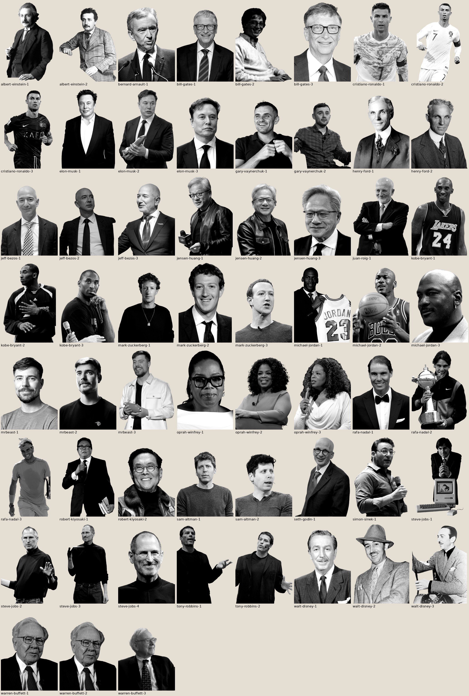

# Recursos · Personajes en B/N

Base de retratos recortados en blanco y negro para los motion graphics «estilo Ramiro» (skill `motion-graphic-estilo-ramiro`).
Cada personaje va asociado a temas: si el guion habla de marketing, va Hormozi; de dinero o poder, Bezos; de comunicación o innovación, Jobs; etc.



- **59 retratos de 24 personajes**: PNG en escala de grises con transparencia (recorte limpio, sin halo), máx. 1600 px de alto.
- `personajes.json`: temas, palabras clave, por qué encaja y, por foto, posición de la cara (para el ojo de pez y la flecha), autor, licencia y fuente.
- `buscar.py`: sugiere personajes para una frase del guion.
  ```bash
  python3 recursos/personajes/buscar.py "estás perdiendo hasta un 27 % de tus conversiones"
  ```
- Sin foto todavía: **Alex Hormozi**, Charlie Munger y Amancio Ortega (no hay fotos con licencia libre en Wikimedia Commons). Para Hormozi conviene usar la foto que usó Brayan en la skill.

## Estado

- Regla: una foto en un motion siempre va de **cuerpo completo, sin cortes visibles**. Eso significa cuerpo entero, o cuerpo que sigue fuera del encuadre, sin cortes en cabeza ni hombros.
- Ya rehechas con la silueta completa (campo `uso`): Jeff Bezos (3 fotos) y Steve Jobs 1 (con el Macintosh).
- **Pendiente: el resto.** Siguen con el encuadre ajustado de la primera versión.
  - Se rehacen con `herramientas/reprocess_db.py`.
  - Ese script añade además las fotos de cuerpo entero de Buffett y Bezos.

## Mapa de temas

| Personaje | Temas | Fotos |
|---|---|---|
| Alex Hormozi | marketing, ofertas, ventas, captación de clientes, escalar un negocio | — pendiente — |
| Jeff Bezos | dinero, poder, riqueza, largo plazo, obsesión por el cliente, ecommerce | `jeff-bezos-1.png`, `jeff-bezos-2.png`, `jeff-bezos-3.png` |
| Steve Jobs | comunicación, innovación, producto, diseño, presentar, storytelling | `steve-jobs-1.png`, `steve-jobs-2.png`, `steve-jobs-3.png`, `steve-jobs-4.png` |
| Elon Musk | ambición, riesgo, tecnología, primeros principios, trabajo duro, visión | `elon-musk-1.png`, `elon-musk-2.png`, `elon-musk-3.png` |
| Warren Buffett | inversión, paciencia, interés compuesto, ahorro, valor | `warren-buffett-1.png`, `warren-buffett-2.png`, `warren-buffett-3.png` |
| Charlie Munger | sabiduría, decisiones, modelos mentales, evitar errores | — pendiente — |
| Bill Gates | tecnología, software, aprendizaje, lectura, filantropía | `bill-gates-1.png`, `bill-gates-2.png`, `bill-gates-3.png` |
| Mark Zuckerberg | redes sociales, comunidad, publicidad online, velocidad, startups | `mark-zuckerberg-1.png`, `mark-zuckerberg-2.png`, `mark-zuckerberg-3.png` |
| Gary Vaynerchuk | contenido, marca personal, atención, redes sociales, constancia | `gary-vaynerchuk-1.png`, `gary-vaynerchuk-2.png` |
| Oprah Winfrey | comunicación, audiencia, empatía, medios, marca personal | `oprah-winfrey-1.png`, `oprah-winfrey-2.png`, `oprah-winfrey-3.png` |
| Tony Robbins | motivación, mentalidad, desarrollo personal, energía, hábitos | `tony-robbins-1.png`, `tony-robbins-2.png` |
| Robert Kiyosaki | educación financiera, activos, ingresos pasivos, libertad financiera | `robert-kiyosaki-1.png`, `robert-kiyosaki-2.png` |
| Simon Sinek | propósito, el porqué, liderazgo, comunicación, equipos | `simon-sinek-1.png` |
| Seth Godin | marketing, marca, tribu, diferenciación, vaca púrpura | `seth-godin-1.png` |
| MrBeast | creadores de contenido, YouTube, viralidad, retención, reinversión | `mrbeast-1.png`, `mrbeast-2.png`, `mrbeast-3.png` |
| Jensen Huang | inteligencia artificial, tecnología, chips, visión | `jensen-huang-1.png`, `jensen-huang-2.png`, `jensen-huang-3.png` |
| Sam Altman | inteligencia artificial, ChatGPT, startups, futuro | `sam-altman-1.png`, `sam-altman-2.png` |
| Bernard Arnault | lujo, marca premium, posicionamiento, riqueza | `bernard-arnault-1.png` |
| Amancio Ortega | empresa española, retail, humildad, trabajo, logística | — pendiente — |
| Juan Roig | empresa española, cliente, cultura de empresa, esfuerzo | `juan-roig-1.png` |
| Cristiano Ronaldo | disciplina, constancia, alto rendimiento, marca personal | `cristiano-ronaldo-1.png`, `cristiano-ronaldo-2.png`, `cristiano-ronaldo-3.png` |
| Rafa Nadal | esfuerzo, resiliencia, humildad, competir | `rafa-nadal-1.png`, `rafa-nadal-2.png`, `rafa-nadal-3.png` |
| Michael Jordan | competitividad, ganar, fracaso, excelencia | `michael-jordan-1.png`, `michael-jordan-2.png`, `michael-jordan-3.png` |
| Kobe Bryant | mentalidad, obsesión, trabajo, mamba mentality | `kobe-bryant-1.png`, `kobe-bryant-2.png`, `kobe-bryant-3.png` |
| Walt Disney | creatividad, imaginación, storytelling, sueños, experiencia | `walt-disney-1.png`, `walt-disney-2.png`, `walt-disney-3.png` |
| Albert Einstein | conocimiento, aprendizaje, curiosidad, inteligencia, interés compuesto | `albert-einstein-1.png`, `albert-einstein-2.png` |
| Henry Ford | sistemas, procesos, producción, eficiencia | `henry-ford-1.png`, `henry-ford-2.png` |

## Cómo se usa en una escena

`herramientas/prep_persona.py bbdd personajes.json <id> <n> salida.png` aplica el ojo de pez de la skill centrado en la cara guardada y funde los hombros cortados por el borde de la foto. La composición coloca a la persona por el alto de cara (`cara.h`) y pone la punta de la flecha a la derecha de la cara (`cara.cx`, `cara.cy`).

## Cómo se hizo (y cómo ampliarla)

1. `herramientas/fetch_v2.py`: candidatas desde los artículos de Wikipedia (en, es, de, fr, it, pt) y la imagen principal de Wikidata, puntuadas por detección de cara (YuNet): plano medio, de frente, una sola persona.
2. Selección manual sobre hojas de contacto (`sheet_candidates.py`).
3. `herramientas/process_selected.py`: descarga, licencia, encuadre de plano medio, recorte con BiRefNet, estimación de primer plano (sin halo), B/N con el contraste de la skill.
4. Para añadir a alguien: una entrada en `herramientas/config.json` y repetir 1–3.

## Derechos

Las fotos vienen de Wikimedia Commons con licencias libres (dominio público, CC BY, CC BY-SA). **CC BY y CC BY-SA obligan a citar al autor** (por ejemplo en el copy del anuncio o en los créditos). La licencia cubre la foto, no la imagen de la persona. Usar a un famoso en un **anuncio pagado** puede sugerir que respalda la marca y en España el uso comercial de la imagen de una persona necesita su consentimiento. Para contenido orgánico o editorial el riesgo es menor. Úsalos como metáfora visual de una idea, nunca como testimonio ni con frases inventadas.

### Créditos

| Archivo | Autor | Licencia | Fuente |
|---|---|---|---|
| `jeff-bezos-1.png` | U.S. Space Force image by Van Ha | Public domain | [Commons](https://commons.wikimedia.org/wiki/File%3AJeff_Bezos_visits_LAAFB_SMC_%283908618%29_%28cropped%29.jpeg) |
| `jeff-bezos-2.png` | DoD photo by Senior Master Sgt. Adrian Cadiz (Released) | Public domain | [Commons](https://commons.wikimedia.org/wiki/File%3ASecretary_of_Defense_Ash_Carter_meets_with_Jeff_Bezos%2C_May_5%2C_2016_%281%29_%28cropped%29.jpg) |
| `jeff-bezos-3.png` | SECWAR | Public domain | [Commons](https://commons.wikimedia.org/wiki/File%3A260202-D-PM193-2205_SECWAR_Arsenal_of_Freedom_Tour_-_Florida_%283x4_cropped_on_Bezos_and_rotated%29.jpg) |
| `steve-jobs-1.png` | Photo: Bernard Gotfryd - Edited from tif by Cart | Public domain | [Commons](https://commons.wikimedia.org/wiki/File%3ASteve_Jobs_and_Macintosh_computer%2C_January_1984%2C_by_Bernard_Gotfryd_-_edited.jpg) |
| `steve-jobs-2.png` | Acaben, cropped by Kyro | CC BY-SA 2.0 | [Commons](https://commons.wikimedia.org/wiki/File%3ASteve_Jobs_WWDC07.jpg) |
| `steve-jobs-3.png` | Matthew Yohe | CC BY 3.0 | [Commons](https://commons.wikimedia.org/wiki/File%3ASteve_Jobs.jpg) |
| `steve-jobs-4.png` | Matthew Yohe at en.wikipedia | CC BY-SA 3.0 | [Commons](https://commons.wikimedia.org/wiki/File%3ASteve_Jobs_Headshot_2010_%28cropped_4%29.jpg) |
| `elon-musk-1.png` | The Royal Society | CC BY-SA 3.0 | [Commons](https://commons.wikimedia.org/wiki/File%3AElon_Musk_Royal_Society.jpg) |
| `elon-musk-2.png` | ver fuente | Public domain | [Commons](https://commons.wikimedia.org/wiki/File%3ASpaceX_CEO_Elon_Musk_visits_N%26NC_and_AFSPC_%28190416-F-ZZ999-006%29_%28cropped%29.jpg) |
| `elon-musk-3.png` | Gage Skidmore | CC BY-SA 4.0 | [Commons](https://commons.wikimedia.org/wiki/File%3AElon_Musk_-_54820081119_%28cropped%29.jpg) |
| `warren-buffett-1.png` | USA International Trade Administration | Public domain | [Commons](https://commons.wikimedia.org/wiki/File%3AWarren_Buffett_at_the_2015_SelectUSA_Investment_Summit_%28cropped%29.jpg) |
| `warren-buffett-2.png` | USA International Trade Administration | Public domain | [Commons](https://commons.wikimedia.org/wiki/File%3AWarren_Buffett_at_the_2015_SelectUSA_Investment_Summit.jpg) |
| `warren-buffett-3.png` | Mark Hirschey | CC BY-SA 2.0 | [Commons](https://commons.wikimedia.org/wiki/File%3AWarren_Buffett_KU_Visit.jpg) |
| `bill-gates-1.png` | © European Union, 2026 | CC BY 4.0 | [Commons](https://commons.wikimedia.org/wiki/File%3ABill_Gates_at_the_European_Commission_-_P067383-987995_%28cropped%29_5.jpg) |
| `bill-gates-2.png` | Tandy Corporation | Public domain | [Commons](https://commons.wikimedia.org/wiki/File%3ABill_Gates_with_Tandy_2000_running_Windows_1.0_%281984%29.jpg) |
| `bill-gates-3.png` | DFID - UK Department for International Development | CC BY 2.0 | [Commons](https://commons.wikimedia.org/wiki/File%3ABill_Gates_June_2015.jpg) |
| `mark-zuckerberg-1.png` | Jeff Sainlar; Social Producer and Editor, Meta | CC BY-SA 4.0 | [Commons](https://commons.wikimedia.org/wiki/File%3AMark_Zuckerberg_%282025%29.jpg) |
| `mark-zuckerberg-2.png` | Guillaume Paumier | CC BY 3.0 | [Commons](https://commons.wikimedia.org/wiki/File%3AMark_Zuckerberg_at_the_37th_G8_Summit_in_Deauville_018_v1.jpg) |
| `mark-zuckerberg-3.png` | Anthony Quintano from Honolulu, HI, United States | CC BY 2.0 | [Commons](https://commons.wikimedia.org/wiki/File%3AMark_Zuckerberg_F8_2018_Keynote_%28cropped%29.jpg) |
| `gary-vaynerchuk-1.png` | Vaynermedia | CC0 | [Commons](https://commons.wikimedia.org/wiki/File%3AGary_Vaynerchuk_public_domain.jpg) |
| `gary-vaynerchuk-2.png` | Andrew Kelly | CC BY 2.0 | [Commons](https://commons.wikimedia.org/wiki/File%3AGary_Vaynerchuk_%282015%29.jpg) |
| `oprah-winfrey-1.png` | US Embassy South Africa | Public domain | [Commons](https://commons.wikimedia.org/wiki/File%3AOprah_Winfrey_2016.jpg) |
| `oprah-winfrey-2.png` | INTX: The Internet & Television Expo | CC BY 2.0 | [Commons](https://commons.wikimedia.org/wiki/File%3A2011_Oprah_at_The_Cable_Show_%2829902986311%29_%282%29.jpg) |
| `oprah-winfrey-3.png` | https://www.flickr.com/photos/aphrodite-in-nyc | CC BY 2.0 | [Commons](https://commons.wikimedia.org/wiki/File%3AOprah_in_2014.jpg) |
| `tony-robbins-1.png` | Randy Stewart | CC BY-SA 2.0 | [Commons](https://commons.wikimedia.org/wiki/File%3ATony_Robbins_gesturing.jpg) |
| `tony-robbins-2.png` | Brian Solis | CC BY 2.0 | [Commons](https://commons.wikimedia.org/wiki/File%3AThe_Twitter_Conference_-_Tony_Robbins.jpg) |
| `robert-kiyosaki-1.png` | Gage Skidmore | CC BY-SA 3.0 | [Commons](https://commons.wikimedia.org/wiki/File%3ARobert_Kiyosaki_by_Gage_Skidmore.jpg) |
| `robert-kiyosaki-2.png` | Gage Skidmore | CC BY-SA 3.0 | [Commons](https://commons.wikimedia.org/wiki/File%3ARobert_Kiyosaki_by_Gage_Skidmore_2.jpg) |
| `simon-sinek-1.png` | Lance Cpl. Brendan Mullin | Public domain | [Commons](https://commons.wikimedia.org/wiki/File%3ASimon_Sinek_speaks_to_I_MIG_Marines_%282%29_%28cropped%29.jpg) |
| `seth-godin-1.png` | Joi Ito | CC BY 2.0 | [Commons](https://commons.wikimedia.org/wiki/File%3ASeth_Godin_in_2009.jpg) |
| `mrbeast-1.png` | Tyren Redd | CC BY 4.0 | [Commons](https://commons.wikimedia.org/wiki/File%3AMrBeast_in_2026_%28cropped_4%29.png) |
| `mrbeast-2.png` | Steven Khan | CC BY 4.0 | [Commons](https://commons.wikimedia.org/wiki/File%3AMrBeast_2023_%28cropped%29.jpg) |
| `mrbeast-3.png` | NickRewind | CC BY 3.0 | [Commons](https://commons.wikimedia.org/wiki/File%3AMrBeast_KCA2023_104_%28cropped%29_2.jpg) |
| `jensen-huang-1.png` | 總統府 | CC BY 2.0 | [Commons](https://commons.wikimedia.org/wiki/File%3AJensen_Huang_20231109.jpg) |
| `jensen-huang-2.png` | Prime Minister's Office Parent institution | GODL-India | [Commons](https://commons.wikimedia.org/wiki/File%3AJensen_Huang_%28cropped%29.jpg) |
| `jensen-huang-3.png` | The White House | Public domain | [Commons](https://commons.wikimedia.org/wiki/File%3AJen-Hsun_Huang_2025.jpg) |
| `sam-altman-1.png` | Steve Jurvetson | CC BY 2.0 | [Commons](https://commons.wikimedia.org/wiki/File%3ASam_Altman_speaking_at_TED_%28cropped%29.jpg) |
| `sam-altman-2.png` | TechCrunch | CC BY 2.0 | [Commons](https://commons.wikimedia.org/wiki/File%3ASam_Altman_TechCrunch_SF_2019_Day_2_Oct_3_%28cropped%29.jpg) |
| `bernard-arnault-1.png` | Jérémy Barande | CC BY-SA 2.0 | [Commons](https://commons.wikimedia.org/wiki/File%3ABernard_Arnault_%283%29_-_2017_%28cropped%29.jpg) |
| `juan-roig-1.png` | Junta Informa | CC BY-SA 2.0 | [Commons](https://commons.wikimedia.org/wiki/File%3AJuan_Roig_-_13.10.18_Visita_B.L._Mercadona.Guadix_4.jpg) |
| `cristiano-ronaldo-1.png` | Bryan Berlin | CC BY-SA 4.0 | [Commons](https://commons.wikimedia.org/wiki/File%3ACristiano_Ronaldo_Croatia_v_Portugal_2_July_2026-075_%28cropped%29.jpg) |
| `cristiano-ronaldo-2.png` | Анна Нэсси | CC BY-SA 3.0 | [Commons](https://commons.wikimedia.org/wiki/File%3ACristiano_Ronaldo_Portugal.jpg) |
| `cristiano-ronaldo-3.png` | Student News Agency Attribution | Attribution | [Commons](https://commons.wikimedia.org/wiki/File%3ACristiano_Ronaldo_playing_for_Al_Nassr_FC_against_Persepolis%2C_September_2023_%28cropped%29.jpg) |
| `rafa-nadal-1.png` | Barcex | CC BY-SA 4.0 | [Commons](https://commons.wikimedia.org/wiki/File%3ARafael_Nadal_en_2024_%28cropped%29.jpg) |
| `rafa-nadal-2.png` | Christopher Johnson from Tokyo, Japan | CC BY-SA 2.0 | [Commons](https://commons.wikimedia.org/wiki/File%3ARafael_Nadal_mordiendo_la_copa_-_0027_Japan_Open_Tennis_Tokio_2010.jpg) |
| `rafa-nadal-3.png` | Tatiana from Moscow, Russia | CC BY-SA 2.0 | [Commons](https://commons.wikimedia.org/wiki/File%3ARafael_Nadal_%2816207904747%29.jpg) |
| `michael-jordan-1.png` | United Press International | Public domain | [Commons](https://commons.wikimedia.org/wiki/File%3AMichael_Jordan_holds_up_his_Chicago_Bulls_jersey_on_September_12%2C_1984.jpg) |
| `michael-jordan-2.png` | Steve Lipofsky Basketballphoto.com | GFDL | [Commons](https://commons.wikimedia.org/wiki/File%3ASteve_Lipfosky_--_Michael_Jordan_%281997%29_%28cropped%29_3x4.jpg) |
| `michael-jordan-3.png` | Joshua Massel. Cropped by en:User:Quadzilla99 | CC BY-SA 2.0 | [Commons](https://commons.wikimedia.org/wiki/File%3AMichael_Jordan.jpg) |
| `kobe-bryant-1.png` | Keith Allison from Hanover, MD, USA | CC BY-SA 2.0 | [Commons](https://commons.wikimedia.org/wiki/File%3AKobe_Bryant_2015.jpg) |
| `kobe-bryant-2.png` | Keith Allison from Kinston, USA | CC BY-SA 2.0 | [Commons](https://commons.wikimedia.org/wiki/File%3AKobe_Bryant_07.jpg) |
| `kobe-bryant-3.png` | RedMedia from Manila, Philippines | CC BY 2.0 | [Commons](https://commons.wikimedia.org/wiki/File%3AKobe_Asia_09.jpg) |
| `walt-disney-1.png` | autor desconocido | Public domain | [Commons](https://commons.wikimedia.org/wiki/File%3AWalt-Disney-1956-crop.jpg) |
| `walt-disney-2.png` | New York World-Telegram and the Sun staff photographer: Fisher, Alan, photographer | Public domain | [Commons](https://commons.wikimedia.org/wiki/File%3AWalt_Disney_NYWTS.jpg) |
| `walt-disney-3.png` | not listed. New York World-Telegram and the Sun Newspaper Photograph Collection | CC0 | [Commons](https://commons.wikimedia.org/wiki/File%3AWalt_Disney_with_film_roll_and_Mickey_Mouse_on_his_right_arm%2C_year_1935.jpg) |
| `albert-einstein-1.png` | ver fuente | Public domain | [Commons](https://commons.wikimedia.org/wiki/File%3AEinstein_1921_by_F_Schmutzer_-_restoration.jpg) |
| `albert-einstein-2.png` | Lucien Chavan / ETH Zürich | Public domain | [Commons](https://commons.wikimedia.org/wiki/File%3AAlbert_Einstein_ETH-Bib_Portr_05937.jpg) |
| `henry-ford-1.png` | ver fuente | Public domain | [Commons](https://commons.wikimedia.org/wiki/File%3AHenry_ford_1919.jpg) |
| `henry-ford-2.png` | Ford Motor Company. Photographic Department | Public domain | [Commons](https://commons.wikimedia.org/wiki/File%3AHenry_Ford_portrait_1915_original_%283x4_cropped%29.png) |
